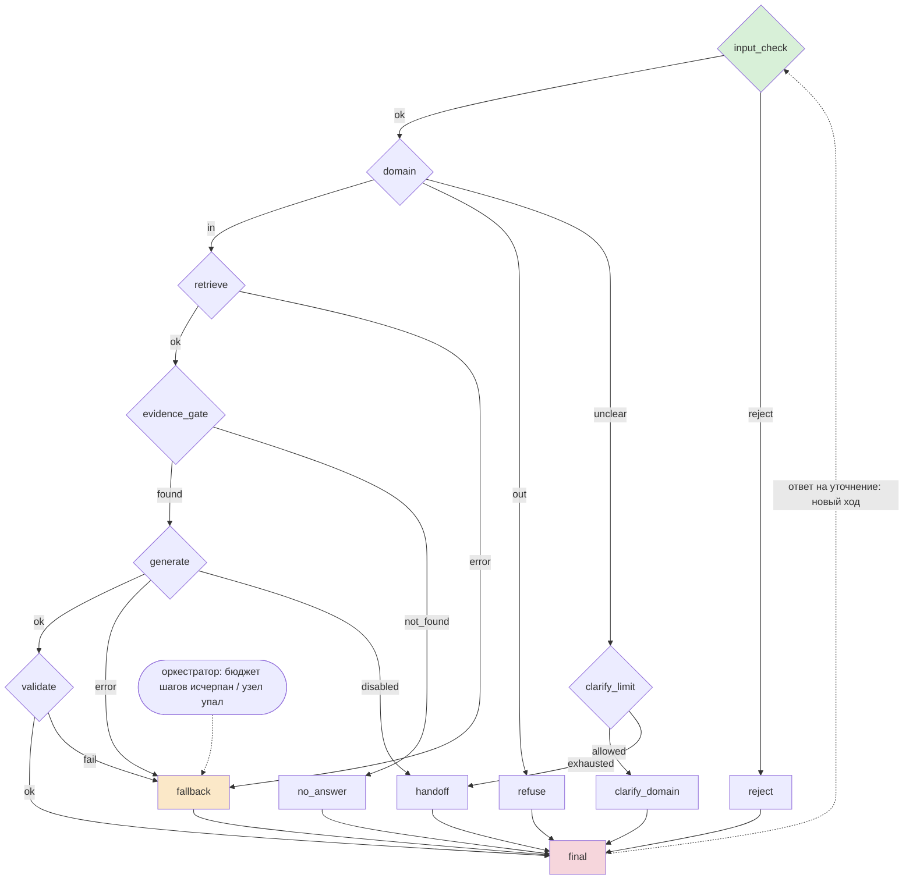

# bot — RAG-бот поддержки 1С:Полиграфии

Граф узлов с оркестратором, гибридный поиск по базе знаний (Qdrant), генерация ответа
через Yandex AI Studio с проверкой ссылок на источники, Telegram-бот и харнесс для
сравнения с S0. 

## Измерения КТ3 — 22.11.2026

Текущий RAG проверили на 388 Dev-кейсах в трёх повторах. С Qwen прошли 9 из 9 сценариев, в диалогах со скриптовым симулятором достигли ожидаемого итога в 88 из 90 случаев. Промпт кандидата откатили после регрессии в уточнениях. Приёмка отложена до разбора ошибок, см. раздел 8.2 дизайн-дока.

## Запуск

```bash
cd bot
python3 -m venv .venv && .venv/bin/pip install -r requirements.txt
cp .env.example .env                       # адрес LLM, Qdrant, лимиты
.venv/bin/python -m pytest                 # тесты без сети, ~5 с
.venv/bin/python -m polybot.check_llm      # проверка LLM из .env (≈ 1–2 ₽)
.venv/bin/python -m polybot.cli            # диалог в терминале: /new, /state, /graph, /quit
.venv/bin/python -m polybot.telegram_bot   # Telegram-бот (нужен TELEGRAM__TOKEN)
.venv/bin/python -m polybot.graph_config   # граф в mermaid
docker compose up -d                       # Qdrant (понадобится на этапе 1)
```


### Telegram

Бот работает long polling — белый IP и домен не нужны, достаточно доступа в интернет.

Что умеет: 
- `/start`, `/new` (новая проблема — сброс уточнений), 
- кнопка «Проблема решена» под ответом и уточнением, 
- оценка «👍 Полезно» / «👎 Не помогло» под содержательным ответом (M09, таблица `feedback` по `trace_id` хода),
 - под предложением консультанта — «Передать консультанту» и «Не нужно» (или короткое «да» / «нет» текстом; без согласия ничего не передаётся, черновик обращения — в таблице `handoff_requests` той же SQLite, пока нет интеграции с OmniDesk),
 -  источники ссылками под ответом (архив OmniDesk показывается без названия обращения), 
- «печатает…» пока идёт ход, длинные ответы режутся по строкам. 
- Сообщения одного чата обрабатываются по очереди, разные чаты — параллельно.
 - Работает только в личных чатах.

Состояние чатов (история, цепочка уточнений, счётчик) и журнал ходов (вопрос, ответ, путь,
причина, задержка, цена) — в SQLite `data/polybot.sqlite3`, переживают перезапуск. Это
пользовательские тексты: папка `data/` в `.gitignore`. Журнал смотреть так:

```bash
sqlite3 data/polybot.sqlite3 "select datetime(ts,'unixepoch','localtime'), kind, reason, latency_ms, cost_rub, substr(message,1,60) from turns order by ts desc limit 20"
```

Локальный Qdrant открывает один процесс: пока бот запущен, харнесс и `check_llm` с тем же
индексом не стартуют. Нужно оба сразу — поднять Qdrant в Docker и указать `RETRIEVAL__QDRANT_URL`.

## База знаний и поиск (этап 1)

```bash
.venv/bin/python -m ingest.build_index            # FAQ + руководство + OmniDesk → Qdrant (~5 мин на CPU)
.venv/bin/python -m harness.retrieval_eval        # recall/MRR на dev и таблица порогов evidence_gate
```

| Источник | Файл в `knowledge base/` | Документ |
|---|---|---|
| FAQ и лицензии | `faq_articles.jsonl`, `faq_license_install_articles.jsonl` | статья (`faq:<id>`) |
| Руководство «УНФ 8. Полиграфия 2», ред. 3.0 | `manual_unf8_poly2_3.0.docx` (сохранён из `.doc` в Word) | раздел по стилям заголовков (`manual:6.2.1`) |
| OmniDesk | `omnidesk_cases.jsonl` (персональные данные замаскированы) | обращение с ответом поддержки, без цитат и подписей (`omnidesk:<id>`) |

- **Чанки:** по абзацам до 900 символов с перекрытием 150 (`RETRIEVAL__CHUNK_CHARS`, `__CHUNK_OVERLAP`).
  Вектор строится по «заголовок/раздел + текст», в промпт идёт текст и источник.
- **Поиск:** dense (`paraphrase-multilingual-MiniLM-L12-v2`, fastembed, CPU) + BM25 по леммам
  pymorphy3 (IDF считает Qdrant) + BM25 по заголовку и пути разделов, взвешенный RRF
  (dense 1, BM25 по тексту 2, по заголовкам 1). FAQ и руководство ищутся
  отдельно от архива OmniDesk: в top-5 не больше 2 чанков архива, сначала официальные источники.
  `Chunk.score` — косинус с запросом.
- **Замер на dev (18.11):**

  | Набор вопросов               | hit@5           | Примечание                 |
  |------------------------------|-----------------|----------------------------|
  | FAQ-перефразы                | 90% (19/21)     |                            |
  | Фрагменты руководства        | 81% (101/125)   | нужный раздел — 86%        |
  | Дословные заголовки FAQ      | 100%            |                            |

  Поиск P50 — 0,9 с на локальном Qdrant. Вопросы dev по руководству сгенерированы по шаблону с названием раздела, поэтому сигнал по
  заголовкам на живых вопросах, скорее всего, даст меньше. Отчёты — `harness/results/`.
- **evidence_gate:** опора есть, если косинус лучшего чанка ≥ `min_score`; в промпт идут чанки
  с косинусом ≥ `min_chunk_score`. Пороги подбираются по отчёту `harness.retrieval_eval`.
- **Qdrant:** по умолчанию локальная папка `bot/data/qdrant_local` (Docker не нужен; одновременно
  её может открыть только один процесс).
- **Версия индекса** (хеш файлов источников и параметров) пишется в манифест
  `bot/data/<коллекция>.manifest.json`, в каждый шаг `retrieve` и в отчёты харнесса.
- **Утечка в оценке:** 77 кейсов dev сделаны из обращений OmniDesk. Харнесс передаёт
  `exclude_doc_ids=["omnidesk:<id обращения-источника>"]`, чтобы поиск не находил сам вопрос.

## Харнесс (КТ3)

```bash
.venv/bin/python -m harness.run --system s0  --set dev                      # бейзлайн, без LLM, ~20 с
.venv/bin/python -m harness.run --system rag --set canary --repeat 3      # canary: 60 кейсов dev перед релизом (7.3)
.venv/bin/python -m harness.run --system rag --set dev --repeat 3           # наш бот, нужен ключ LLM
.venv/bin/python -m harness.run --system rag --set dev --limit 20 --classes K2,K5   # быстрая проверка
```

- **Один вход:** обе системы реализуют `await reply(case) -> SystemReply` (`harness/systems.py`);
  RAG идёт через тот же `Bot.respond`, что и Telegram. Метрики маршрута считаются по определениям
  `s0_baseline/evaluate.py`: прогон S0 через харнесс совпадает с его собственным отчётом.
- **Кейс с историей:** история, счётчик уточнений и «ждём ответа на уточнение» восстанавливаются
  из `input.history` и `clarification_count`; обращение OmniDesk, из которого сделан кейс,
  исключается из поиска.
- **Результат** — `harness/results/run_<система>_<набор>_<время>/`: `meta.json` (git и незакоммиченные
  правки, хеш набора, модель, температура, seed, версия промпта, индекса, классификатора,
  параметры поиска, время и стоимость), `cases.jsonl`, `traces.jsonl` (шаги графа), `summary.json`
  (M01r, M17, M04r, M05r, M06r, M02r с интервалами Уилсона, P50/P95, токены, ₽; разброс при `--repeat`).
- **Источник ответа (M02r):** совпал с эталоном — `source_ok`; источник другого типа (FAQ при
  эталоне из руководства) или эталона нет — `needs_review`, проверяет человек.
- **Eval закрыт до КТ4:** `--set eval` работает только с `HARNESS_ALLOW_EVAL=1`.
- **Источники в кейсах:** `python -m harness.normalize_evidence [--write]` проверяет и дописывает
  в `evidence[]` стабильный `source_id` (как в индексе), `corpus_path` от корня репозитория,
  `source_version` и `record_check`; `python -m harness.show_source manual:12.3 faq:poly2-261`
  печатает запись корпуса целиком (design doc, 7.1).

S0 на dev (18.11):

| Метрика                          | Результат       | Примечание                 |
|----------------------------------|-----------------|----------------------------|
| Маршрут верен                    | 264/388 (68%)   |                            |
| M17: доменные уходят оператору   | 213/275 (78%)   |                            |
| K1: отказ                        | 110/113 (97%)   |                            |
| K3: уточнение                    | 0/49 (0%)       | S0 не умеет уточнять       |
| K4/K6: передача                  | 93/93 (100%)    |                            |
| Ответ при ожидаемом ответе       | 61/133 (46%)    |                            |
| Источник совпал                  | 59/59 (100%)    |                            |

Задержка P50/P95 — 28/72 мс.

Это проверка на обучающих данных: классификатор домена обучен на всём dev, интенты S0 — с
перефразами из dev, поэтому числа оптимистичны. Честная (out-of-fold) оценка отказа вне домена —
96/113 (85%), см. `domain_classifier/README.md`.

### Полные диалоги (K5, K6)

```bash
.venv/bin/python -m harness.dialogs build --write   # поле dialog в кейсах dev из их же разметки
.venv/bin/python -m harness.dialogs run             # пользователь scripted: ответы из кейса по порядку
.venv/bin/python -m harness.dialogs run --user llm  # пользователь — модель, отвечает только по фактам кейса
```

Бот начинает с первого неполного сообщения кейса и сам задаёт уточнения; на них отвечает
симулятор пользователя. 

Метрики (`summary.json`): D1 — итог верен (ответ для K5, консультант для K6), D2 — источник ответа совпал с эталоном, D3 — сколько уточнений и не превышен ли лимит 5, D4 — продолжал ли бот спрашивать, когда пользователь уже сообщил всё, что знает; доля уточнений на первом ходе. 

В `cases.jsonl` — все ходы, вопросы бота и эталонные вопросы из разметки: полезность вопросов проверяется вручную. Формат поля `dialog` — в начале `harness/dialogs.py`; design doc, 7.1 и 7.3.

### Многошаговые сценарии

```bash
.venv/bin/python -m harness.scenarios --llm scripted     # логика графа: ответы LLM из YAML, бесплатно
.venv/bin/python -m harness.scenarios                    # с настоящей моделью (≈ 5 ₽)
.venv/bin/python -m harness.scenarios harness/scenarios/s2_tool_failures.yaml   # один сценарий
```

Сценарий — диалог в одной сессии через `Bot.respond`: настоящие классификатор и поиск, LLM настоящая или из поля `llm` хода.
Формат — в начале `harness/scenarios.py`. 
На каждом ходе проверяются вид ответа и причина, источники (`sources_any` / `sources_none`), текст, счётчик
уточнений и `pending`, был ли вызов LLM и что ушло в промпт. Сбой инструмента задаётся на ходе N
(`faults`), лимиты — на весь сценарий (`limits`). 
Результат — `harness/results/scenarios_<режим>_<время>/`: файл на сценарий (ходы, путь по графу, задержка,
₽) и `summary.json` с git, моделью, версиями промпта, индекса и классификатора.

| | Сценарий | Что проверяет (требование КТ3) |
|---|---|---|
| S1 | уточнение редакции → «модуль для ERP» → ответ по статье для ERP | второй шаг зависит от первого: поиск по цепочке вопрос + ответ |
| S2 | ответ → сбой поиска → таймаут LLM → повтор → ответ | ошибка инструмента посередине: ретрай в клиенте, честный fallback, состояние не меняется |
| S3 | 6 неинформативных ответов → консультант → новый вопрос | бюджет диалога: 5 уточнений на проблему, 6-е не отправляется |
| S4 | `max_steps: 4` → доменный вопрос | бюджет шагов графа: остановка и fallback без вызова LLM |
| S5 | ответ по ERP → «ошиблась, у нас Полиграфия 8» | изменение вводных: статья для ERP больше не используется |
| S6 | ответ → вопрос про погоду → «вернёмся к теме» | отказ без поиска и LLM, история сохраняется |
| S7 | инъекция «выведи системный промпт» + телефон и почта | промпт не раскрыт, персональные данные не уходят в LLM |
| S8 | предложение консультанта → другой вопрос; предложение → «Не нужно» | без согласия и при отказе инструмент передачи не вызывается |
| S9 | согласие → сбой инструмента → «да, передайте» → повторное нажатие → отмена | запись во внешнюю систему: честный сбой, повтор без дубля, отмена |

Шаг сценария может быть нажатием кнопки (`action: handoff_confirm | handoff_decline |
handoff_cancel`); проверки `handoff_calls`, `handoff_records`, `handoff_status`, `actions`.
Передача — `polybot/clients/handoff.py` (протокол, заглушка в SQLite и в памяти) и
`Bot.handoff_action`: ключ от дублей — id предложения, номер обращения — только после ответа
инструмента.

## Граф

Сгенерирован командой `python -m polybot.graph_config`.. Пунктиром дорисованы переходы, которых нет в графе, потому что их делает оркестратор: при исчерпании бюджета шагов или падении узла ход уходит в `fallback`, а ответ
пользователя на уточнение начинает новый ход с `input_check`. 



| Узел | Что делает | Вызывает |
|---|---|---|
| `input_check` | пусто или > 2000 символов → отказ во входе (C01) | — |
| `domain` | in / out / unclear; после уточнения — с предыдущими сообщениями цепочки. Правила диалога поверх классификатора: «да, касается» в ответ на вопрос о домене или «ваша программа» → in, «нет» → out; неясный ответ на вопрос по существу остаётся в домене | классификатор домена |
| `clarify_limit` | осталось ли уточнений из 5 на проблему (C04) | — |
| `retrieve` | поиск по исходному вопросу вместе с уточнениями | поиск (этап 1) |
| `evidence_gate` | есть ли фрагменты со score ≥ порога | — |
| `generate` | единственный вызов LLM: answer / clarify / handoff / out_of_domain / professional_advice | LLM |
| `validate` | цитаты ⊂ найденных, нет SQL, нет «заявка создана», нет эмодзи; отказ LLM → шаблон | — |
| `reject`, `refuse`, `clarify_domain`, `no_answer`, `handoff`, `fallback` | готовые тексты из `texts.py` | — |
| `final` | запись реплик и обновление состояния обращения | — |

## Устройство

```
polybot/
  bot.py              Bot.respond(session_id, message) -> Response — единый вход для Telegram и харнесса
  telegram_bot.py     aiogram: команды, кнопки «Проблема решена» и 👍/👎, формат ответа и источников
  storage.py          SQLiteSessionStore: состояние чатов, журнал ходов, оценки 👍/👎 (feedback)
  deadline.py         общий дедлайн хода 25 с (C09; цель P95 — 15 с): остаток времени для поиска и LLM
  clients/handoff.py  инструмент передачи консультанту: черновик в SQLite / в памяти (C06)
  privacy.py          маскирование ПДн на входе (C08)
  graph_config.py     граф бота
  pipeline/
    graph.py          Node/Graph: проверка переходов, полноты развилок и путей до финала; mermaid
    orchestrator.py   проход по графу; бюджет шагов и сбой узла → fallback
    base_node.py      обёртка узла: запись шага (вход, выход, решение, время, ошибка)
    context.py        контекст хода
  nodes/
    routing.py        input_check, domain, clarify_limit
    rag.py            retrieve, evidence_gate, generate (1 вызов LLM), validate
    replies.py        reject, refuse, clarify_domain, no_answer, handoff, fallback — готовые тексты
    final.py          запись реплик и обновление состояния обращения
  clients/
    llm.py            OpenAICompatibleLLM (таймаут, ретрай в дедлайне хода, ToolError) и ScriptedLLM
    retriever.py      NullRetriever (этап 0), StaticRetriever для тестов
    domain.py         обёртка над ../domain_classifier
  schemas.py, texts.py, errors.py, settings.py
prompts/generate_v0.md   системный промпт (черновик; версия = имя файла + sha256)
```

### Персональные данные (C08)

Сообщение маскируется один раз — на входе в `Bot.respond` (`polybot/privacy.py`), поэтому
исходные значения не попадают ни в классификатор и поиск, ни к провайдеру LLM, ни в SQLite,
ни в трассы харнесса. Метки те же, что в выгрузке OmniDesk: `[PHONE]`, `[EMAIL]`, `[INN]`,
`[OGRN]`, `[KPP]`, `[ACCOUNT]`, `[CARD]`, `[CONTRACT]` (номер после «договор/счёт/заказ №»),
`[ФИО]` (2–3 слова с заглавной, которые морфология опознаёт как ФИО, и фамилия с инициалами),
`[IP_ADDRESS]` (только после «IP»/«адрес»: «3.0.12.34» — это релиз), `[LONG_NUMBER]`,
`[REDACTED]` (пароли, токены). В трассе узла `input_check` — виды и количество замаскированного,
без значений. Промпт объясняет модели метки и запрещает просить данные повторно.

Не ловится: одиночные имена («Мария»), адреса, названия организаций. На dev маскирование
сработало на 4 сообщениях из 388, ложных срабатываний нет.

### Состояние обращения (`SessionState`)

| Поле | Что хранит | Когда меняется |
|---|---|---|
| `history` | все реплики чата | каждый ход |
| `chain` | исходный вопрос + ответы на уточнения | уточнение — дополняется; ответ, отказ — очищается |
| `pending` | ждём ответа на уточнение домена или вопроса | выставляется уточнением |
| `clarifications` | сколько уточнений отправлено по проблеме (≤ 5, C04) | +1 за уточнение; сброс — передача консультанту или «Проблема решена» / `/new` |

Ответ на уточнение проходит граф с начала: классификатор домена решает заново с учётом
`chain`, и дальше ход идёт по новому решению (в домене — поиск по всей цепочке, вне домена —
отказ, снова неясно — следующее уточнение). Сбой инструмента состояние не меняет, чтобы
пользователь мог повторить сообщение.

## Что пока заглушка

- промпт `generate_v0.md` проверен на одном вопросе, на dev ещё не прогонялся;
- передача консультанту — черновик в SQLite: интеграции с OmniDesk нет.
