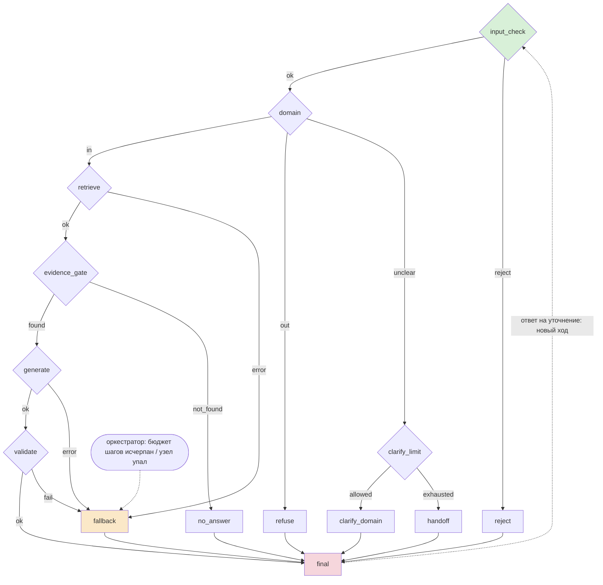

# bot — RAG-бот поддержки 1С:Полиграфии

Этап 0 из [plan_rag_bot.md](../plan_rag_bot.md): каркас — граф узлов, оркестратор, состояние
обращения, клиенты инструментов, тесты маршрутизации. Поиска по базе знаний ещё нет,
поэтому доменные вопросы честно получают «в базе нет надёжного ответа», а LLM не вызывается.

## Запуск

```bash
cd bot
python3 -m venv .venv && .venv/bin/pip install -r requirements.txt
cp .env.example .env                       # адрес LLM, Qdrant, лимиты
.venv/bin/python -m pytest                 # 31 тест, ~5 с
.venv/bin/python -m polybot.cli            # диалог в терминале: /new, /state, /graph, /quit
.venv/bin/python -m polybot.graph_config   # граф в mermaid
docker compose up -d                       # Qdrant (понадобится на этапе 1)
```

LLM — любой OpenAI-совместимый сервер (`LLM__BASE_URL` в `.env`): Ollama на этой или другой
машине, vLLM на GPU-сервере. Для Ollama на другом компьютере в локальной сети там нужно
выставить `OLLAMA_HOST=0.0.0.0`, а здесь указать `http://<IP>:11434/v1`.

## Граф

Сгенерирован командой `python -m polybot.graph_config`. Ромб — развилка, прямоугольник — узел
с одним выходом. Пунктиром дорисованы переходы, которых нет в графе, потому что их делает
оркестратор: при исчерпании бюджета шагов или падении узла ход уходит в `fallback`, а ответ
пользователя на уточнение начинает новый ход с `input_check`. Тест
`test_readme_graph_matches_code` проверяет, что схема здесь совпадает с кодом.



| Узел | Что делает | Вызывает |
|---|---|---|
| `input_check` | пусто или > 2000 символов → отказ во входе (C01) | — |
| `domain` | in / out / unclear; после уточнения — с предыдущими сообщениями цепочки | классификатор домена |
| `clarify_limit` | осталось ли уточнений из 5 на проблему (C04) | — |
| `retrieve` | поиск по исходному вопросу вместе с уточнениями | поиск (этап 1) |
| `evidence_gate` | есть ли фрагменты со score ≥ порога | — |
| `generate` | единственный вызов LLM: answer / clarify / handoff / out_of_domain / professional_advice | LLM |
| `validate` | цитаты ⊂ найденных, нет SQL, нет «заявка создана», нет эмодзи; отказ LLM → шаблон | — |
| `reject`, `refuse`, `clarify_domain`, `no_answer`, `handoff`, `fallback` | готовые тексты из `texts.py` | — |
| `final` | запись реплик и обновление состояния обращения | — |

## Устройство

```
polybot/
  bot.py              Bot.respond(session_id, message) -> Response — единый вход для Telegram и харнесса
  graph_config.py     граф бота
  pipeline/
    graph.py          Node/Graph: проверка переходов, полноты развилок и путей до финала; mermaid
    orchestrator.py   проход по графу; бюджет шагов и сбой узла → fallback
    base_node.py      обёртка узла: запись шага (вход, выход, решение, время, ошибка)
    context.py        контекст хода
  nodes/
    routing.py        input_check, domain, clarify_limit
    rag.py            retrieve, evidence_gate, generate (1 вызов LLM), validate
    replies.py        reject, refuse, clarify_domain, no_answer, handoff, fallback — готовые тексты
    final.py          запись реплик и обновление состояния обращения
  clients/
    llm.py            OpenAICompatibleLLM (таймаут, ретрай, ToolError) и ScriptedLLM для тестов
    retriever.py      NullRetriever (этап 0), StaticRetriever для тестов
    domain.py         обёртка над ../domain_classifier
  schemas.py, texts.py, errors.py, settings.py
prompts/generate_v0.md   системный промпт (черновик; версия = имя файла + sha256)
```

### Состояние обращения (`SessionState`)

| Поле | Что хранит | Когда меняется |
|---|---|---|
| `history` | все реплики чата | каждый ход |
| `chain` | исходный вопрос + ответы на уточнения | уточнение — дополняется; ответ, отказ — очищается |
| `pending` | ждём ответа на уточнение домена или вопроса | выставляется уточнением |
| `clarifications` | сколько уточнений отправлено по проблеме (≤ 5, C04) | +1 за уточнение; сброс — передача консультанту или «Проблема решена» / `/new` |

Ответ на уточнение проходит граф с начала: классификатор домена решает заново с учётом
`chain`, и дальше ход идёт по новому решению (в домене — поиск по всей цепочке, вне домена —
отказ, снова неясно — следующее уточнение). Сбой инструмента состояние не меняет, чтобы
пользователь мог повторить сообщение.

## Что пока заглушка

- `NullRetriever` — поиск по Qdrant появится на этапе 1;
- `SessionStore` в памяти — SQLite на этапе 2;
- промпт `generate_v0.md` не проверялся на модели.
