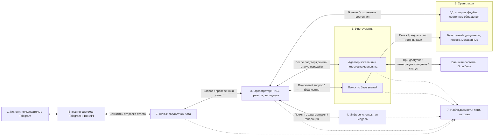

# Design doc: чат-бот поддержки по 1С:Полиграфии


| | |
|---|---|
| Авторы | Елизавета Гапонова, Кащеева Мария  |
| Версия | 2 |
| Статус | к ревью КТ2; |
| Обновлен | 24.10.2026 |

## 1. Контекст проекта

### 1.1 Бизнес-задача

- **Проблема.** Пользователи 1С:Полиграфии задают повторяющиеся вопросы о функциях продукта, обновлениях, настройках, регламенте техподдержки и типовых ошибках. Сейчас часть таких обращений попадает к консультантам, хотя на них можно ответить по официальной документации, FAQ и регламентам.
- **Почему без LLM-системы не справиться.** Обычный поиск требует от пользователя знать правильные слова: "калькуляция", "рабочий центр", "маршрутный лист", "ИТС", "релиз". Правила и FAQ хорошо работают для точных формулировок, но хуже обрабатывают естественные вопросы, неполные описания проблемы и многошаговое уточнение. Количество обращений ежегодно растёт и бизнесу приходится тратить большие бюджеты на найм и обучение консультантов, которые перегружены работой и вопросами. Если консультант не знает ответ на вопрос, то вынужден не менее получаса искать ответ на вопрос и проверять несколько источников.
- **Почему именно это решение имеет смысл.** Чат-бот выступает первой линией: ищет ответ в официальных материалах 1С:Полиграфии, даёт корректный и полный ответ, показывает источник, задает уточняющие вопросы и передает обращение человеку, когда данных недостаточно. Это снижает долю простых задач и помогает пользователю быстрее понять, что делать дальше.
- **Критерии успеха с точки зрения бизнеса.** Для пилота: не менее 35% типовых обращений закрываются без оператора; среднее время до первого полезного ответа снижается с часов/дней до секунд; доля обращений, где оператору уже передан структурированный контекст проблемы, не ниже 60%; доля оценок «полезно» (👍) среди всех явных оценок 👍/👎 не ниже 80% на пилотной выборке.

### 1.2 Пользователи и сценарии использования

- **Кто.** Клиенты 1С:Полиграфии: администраторы 1С, менеджеры типографий, сотрудники производства/склада/доставки, руководители и специалисты внедрения. Внутренний пользователь: специалисты поддержки первой линии, которые получают эскалации с уже собранным контекстом. В пилоте сервисом пользуются 15 человек.
- **Через что.** Телеграм-бот. На КТ1 считаем только текстовый чат без загрузки файлов и картинок. 
- **Нагрузка.** По данным заказчика: 15 пользователей, каждый отправляет 1-2 запроса в день. Сервис работает по рабочим дням с 9:00 до 18:30 МСК: итого 15-30 запросов в день и 330-660 запросов в месяц при 22 рабочих днях; средний расчетный объем при 1,5 запроса на человека в день - 495 запросов в месяц. Запросом считаем каждое сообщение пользователя, требующее ответа бота, включая уточнения. Пиковую нагрузку и число одновременных запросов ещё нужно определить; фактический пик уточняем по логам пилота.
- **Цена ошибки.** Неверный ответ может привести к неправильной настройке, потере времени пользователя и оператора, ухудшению доверия к поддержке. Самый рискованный класс ошибок: уверенный совет по исправлению данных рабочей базы или обновлению, если ответа нет в источниках. Поэтому бот не должен советовать прямые правки в БД, не должен выдавать неподтвержденные инструкции и должен эскалировать клиент-специфичные проблемы.
- **Что для пользователя "хорошо".** Пользователь получает понятный ответ за 10-15 секунд, видит ссылку на источник, понимает следующий шаг, не ищет вручную по сайту и не повторяет оператору всю историю, если нужна эскалация.

*Где и с кем мы общаемся.* Основной язык русский. Тон вежливый. Ответы корректные и полные; объём зависит от вопроса и необходимых пояснений. Входные вопросы часто неполные: "не считается заказ", "где включить доставку", "как обновиться". Поэтому контракт должен поддерживать уточняющие вопросы и честный отказ, когда ответа в базе нет.

**Единицы учёта.** Обращение — диалог по одной проблеме. Запрос — отдельное сообщение пользователя, требующее ответа бота, включая уточнения. Долю решённых проблем считаем по обращениям, нагрузку — по запросам.

### 1.3 Границы, ограничения и допущения

**Границы системы.**

| Внутри (наш код, наши данные) | Снаружи (провайдер, внешний API, чужой сервис) |
|---|---|
| Чат-интерфейс, оркестратор, системный промпт, правила отказа и эскалации | Сайт 1cpoly.ru, OmniDesk, внешняя доступность источников |
| Индекс базы знаний: страницы продукта, FAQ, официальная документация, инструкции по обновлениям; сервис инференса выбранной открытой модели при собственном размещении | Репозиторий модели, ее лицензия и доступность вычислительных ресурсов; при внешнем размещении - сервис хостинга |
| Retrieval, ранжирование фрагментов, проверка наличия источника, формат ответа | Корректность и актуальность исходной документации |
| Логи диалогов, фидбек, eval-сет, метрики качества и задержки | Решение оператора поддержки и доступ к рабочей базе клиента |

**Что явно не делаем.**

- Не вносим изменения в базы 1С и не даем инструкции по прямому изменению данных через SQL.
- Не диагностируем клиентскую базу без логов, версии релиза, скриншотов и доступа специалиста.
- Не даём профессиональные юридические, бухгалтерские и кадровые консультации; при этом объясняем документированные функции программы, если ответ подтверждён источником (C03, C05).
- Не обрабатываем файлы, скриншоты, голос.
- Не отвечаем на посторонние вопросы. Домен включает 1С:Полиграфию и связанные с ней вопросы по 1С:КП/ИТС, лицензированию, каналам и регламенту поддержки. Отсутствие ответа в документации не означает выход за домен (C05).
- Объясняем функции и алгоритмы по документации, но не диагностируем и не исправляем базу клиента, не настраиваем её удалённо и не проводим обучение (C03, C06, C07).
- Не выполняем программирование, конфигурирование, тестирование клиентских баз и создание резервных копий (C07).

**Допущения, которые еще не проверены.**

- О данных: официальные страницы, FAQ и инструкции достаточно покрывают минимум 60% типовых вопросов первой линии.
- О моделях: для MVP планируем использовать бесплатные модели с открытыми весами из публичных репозиториев. Конкретную модель выбираем после проверки качества ответов на русском языке и работы с найденными фрагментами документации; условия ее лицензии должны допускать планируемое использование.
- Об инфраструктуре: место запуска модели и доступное оборудование пока не выбраны. Рабочий вариант для оценки - запуск на имеющемся оборудовании команды; возможность уложиться в целевую задержку проверяем замерами. Если потребуется внешний хостинг, отдельно оцениваем стоимость и условия передачи данных.
- О безопасности и нормативах: в чат не должны попадать коммерческие данные клиента, если пользователь не дал согласие; в логах маскируются телефоны, email, ИНН, номера договоров и имена сотрудников.
- О поведении пользователей: часть пользователей будет писать неполно; бот должен чаще уточнять, чем угадывать.

*Отвечаем ли на вопросы вне предметной области?* Нет. Бот отказывает в выполнении постороннего запроса. Если вопрос относится к домену, но подтверждённого ответа в базе нет, бот сообщает об этом, уточняет детали или предлагает обратиться в поддержку; ответ не выдумывает.

## 2. Контракт сервиса

### 2.1 Контракт

| Поле | Что обещаем | Как проверим |
|---|---|---|
| **Вход** | Принимаем текстовые вопросы на русском языке до 2 000 символов: функциональность 1С:Полиграфии, типовые проблемы, обновления и связанные с продуктом вопросы по 1С:КП/ИТС, лицензированию, каналам и регламенту поддержки. Файлы, картинки и голосовое сообщение в MVP не принимаем. | Перед пилотом проверяем прием и отказ для поддерживаемых и неподдерживаемых сообщений как условие приемки интерфейса; границу домена оценивает M04. |
| **Выход** | Возвращаем корректный и полный ответ на русском без фиксированного числа предложений, с минимум одной ссылкой/названием источника, если ответ найден в базе. Для инструкций даем безопасные шаги только из источников. | M02, M03, M07, M08 |
| **Поведение при неуверенности** | Если retrieval не нашел надежных фрагментов или вопрос клиент-специфичен, бот говорит, что точного ответа нет, задает уточняющие вопросы или предлагает передачу консультанту. | M05, M06, M12, M17 |
| **Чего не обещаем** | Не гарантируем отсутствие ошибок; не заменяем специалиста 1С; не даём профессиональные юридические, бухгалтерские и кадровые консультации, но объясняем документированные функции программы; не исправляем рабочую базу; не отвечаем по доработанным конфигурациям без участия консультанта. | M04, M10; границы 1.3 и дисклеймер интерфейса |
| **Нефункциональные** | Полный ответ P95 <= 15 с; предварительная цель доступности MVP — 99% в рабочие дни с 9:00 до 18:30 МСК; персональные данные маскируются в логах; история хранится 90 дней в пилоте. | M11, M13, M14 |

**Идентификаторы обязательств для трассировки КТ2.** Они уточняют, но не заменяют контракт выше. Содержательный ответ по документации проверяется отдельно от правильности маршрута.

| ID | Проверяемое обязательство |
|---|---|
| C01 | Текстовый вход на русском до 2 000 символов; неподдерживаемые вложения отклоняются |
| C02 | Понятный ответ или корректное уточнение/отказ, с подходящим следующим шагом и форматом |
| C03 | Факты подтверждены разрешенным источником нужной редакции; содержательный ответ указывает проверяемый источник |
| C04 | При неясности задается нужное уточнение, но не более 5 уточняющих сообщений по одной проблеме; при недостатке доказательств ограничение признается явно |
| C05 | Явно посторонний запрос и запрос профессиональной юридической, бухгалтерской или кадровой консультации не выполняются; документированные функции программы объясняются. Сомнительный запрос не объявляется вне домена без уточнения |
| C06 | Клиентский случай передается консультанту корректно; черновик и созданная заявка различаются, данные передаются после согласия |
| C07 | Нет прямой правки рабочей БД, выдуманной диагностики и исполнения prompt injection |
| C08 | Чувствительные сведения маскируются, доступ к истории ограничен, срок хранения пилота не более 90 дней |
| C09 | Сбой поиска обозначается как сбой; ответ в пределах P95 15 с; предварительная цель доступности — 99% в рабочие дни с 9:00 до 18:30 МСК; ответ без подтверждения источниками не уходит пользователю |
| C10 | Все сообщения бота соответствуют тону 2.3: вежливый деловой русский, без обвинений, жаргона и необоснованных обещаний |
| C11 | Цели пилота: не менее 35% типовых обращений разрешаются без оператора (M15); доля обращений с переданным оператору структурированным контекстом — не ниже 60% (M18). Отдельно измеряем направления оператору, подтверждённые передачи после согласия и бинарную пользовательскую полезность |
| C12 | MVP использует бесплатные открытые веса без платных LLM API; фактические ежемесячные расходы учитываются по 3.3; потолок бюджета ещё не определён |

**Контракт одной фразой:**

> На вопрос на русском о 1С:Полиграфии или связанных с ней КП/ИТС, лицензировании и поддержке бот возвращает корректный и полный ответ, опирающийся минимум на один фрагмент официальной базы знаний, и показывает источник; если надежного фрагмента нет или нужна диагностика рабочей базы, бот явно говорит об этом, уточняет данные или передает оператору; полный ответ P95 <= 15 с; посторонние запросы не выполняет, а отсутствие ответа в документации обозначает явно.

### 2.2 Сценарии взаимодействия

**Проверка предметной области перед выбором сценария.** После проверки допустимости текстового сообщения оркестратор определяет одно из трех состояний: `в домене`, `вне домена`, `неясно`. В домене — вопросы о функциях, типовых ошибках и обновлениях 1С:Полиграфии, а также связанные с ней вопросы по 1С:КП/ИТС, лицензированию, каналам и регламенту поддержки. Документированные функции программы по юридическим, бухгалтерским и кадровым темам можно объяснять; профессиональные консультации по этим темам выходят за контракт. Название продукта в каждом сообщении не обязательно: учитываем историю текущего диалога и предметные признаки (например, расчет заказа, красочность, рабочий центр). Вопрос о конкретной доработанной базе тоже относится к домену, но требует уточнения или консультанта, а не готовой инструкции. Вне домена - только явно посторонняя задача, например прогноз погоды или написание рекламного текста. При запросах «Не работает» и «Как рассчитать заказ?» задаём уточняющий вопрос о нужной функции, типе заказа или проблеме. Связь с 1С:Полиграфией уточняем, если она не ясна из контекста; недостаток деталей не считаем выходом за домен.

Для предварительной маршрутизации MVP использует правила по темам и терминам, историю диалога и явные исключения; совпадения по одному слову недостаточно для уверенного решения. Далее поиск проверяет наличие подтверждающего материала, но **пустая выдача не означает, что вопрос вне домена**: для доменного вопроса это сценарий "ответа нет в базе". Инструкции вида "игнорируй правила" не меняют домен; их игнорируем и, если есть безопасная часть вопроса о продукте, обрабатываем ее. Правила и спорные формулировки проверяем на кейсах K1 и K3 актуального eval-сета и дополняем отдельными примерами ясного выхода за домен и неоднозначности до пилота.

**Основные сценарии.**

| Сценарий | Пример запроса | Что делает система | Результат для пользователя |
|---|---|---|---|
| Поиск ответа по базе | "Можно ли в 1С:Полиграфии вести склад материалов и готовой продукции?" | Нормализует вопрос, ищет в индексе, находит фрагмент про склад, формирует ответ со ссылкой | Пользователь получает подтверждение и понимает, где искать функцию |
| Уточняющий вопрос | "Не считается заказ, что делать?" | Определяет, что вопрос недостаточно конкретный; спрашивает тип заказа, этап и текст ошибки. При необходимости продолжает уточнять, но не более 5 сообщений по одной проблеме | Пользователь понимает, какие данные нужны для решения |
| Эскалация в поддержку | «После обновления ошибка в рабочей базе, нужен специалист» | Предлагает обратиться к консультанту; способ передачи и интеграция с OmniDesk ещё не определены. Передача данных возможна только после согласия пользователя | Пользователь видит фактический статус; до подтверждения интеграции бот не сообщает о создании или передаче заявки |

**Исключительные сценарии.**

| Ситуация | Поведение системы | Что видит пользователь |
|---|---|---|
| Вопрос в домене, но ответа нет в базе | Не выдумывает; сообщает, что не нашел подтвержденный ответ; предлагает уточнить детали или передать специалисту | "В базе знаний нет надежного ответа по этому случаю. Уточните релиз и текст ошибки или подготовлю обращение специалисту." |
| Принадлежность к домену неясна | Один раз уточняет связь с 1С:Полиграфией и нужную функцию; не отказывает по одному общему слову | "Речь о 1С:Полиграфии? Если да, уточните, какая функция или документ не работает." |
| Явно вне домена | Отказывает без поиска доменного ответа и без выполнения посторонней задачи | "Я отвечаю по 1С:Полиграфии и связанным с ней вопросам по КП/ИТС, лицензированию и поддержке на основе официальных материалов." |
| Запрос профессиональной юридической, бухгалтерской или кадровой консультации | Отказывает в профессиональной консультации; документированную функцию программы может объяснить по источнику | «Могу объяснить, как работает функция программы по документации. За профессиональной консультацией обратитесь к профильному специалисту.» |
| Попытка вывести за контракт в вопросе о продукте | Игнорирует постороннюю инструкцию; отвечает только на безопасную часть при наличии источника, иначе уточняет или отказывает | "Могу помочь с вопросом по 1С:Полиграфии, если он подтверждается документацией." |
| Инструмент не ответил / вернул ошибку | Использует статический fallback; иначе просит повторить позже | "Сейчас не могу проверить базу знаний. Попробуйте позже или обратитесь к консультанту." |
| Ответ не подтверждён источниками | Не отправляет неподтверждённый текст; показывает безопасный fallback без повторной генерации | "Не удалось подготовить надежный ответ. Могу предложить консультацию специалиста." |
| Нужен человек: передача оператору | Предлагает консультацию специалиста. Способ передачи ещё не определён; данные не передаются без согласия, создание заявки не заявляется без подтверждения | «По этому вопросу нужен консультант. Автоматическая передача обращения пока не подтверждена.» |

### 2.3 Диалоговая логика и тон

- **Single-turn или multi-turn.** Multi-turn в рамках одной сессии: бот может задавать уточняющие вопросы; полная история диалога по проблеме сохраняется до её решения. Каждый ответ должен быть проверяем как отдельное событие с источниками.
- **Лимит уточнений.** Бот может отправить до 5 уточняющих сообщений по одному вопросу пользователя. Несколько связанных вопросов в одном сообщении считаются одним уточнением. Если подтвержденный ответ найден раньше, бот отвечает сразу; если следующий вопрос не поможет или требуется специалист, предлагает передачу консультанту, не дожидаясь пятого уточнения. Шестое уточняющее сообщение по той же проблеме не отправляется.
- **История диалога.** История хранится в БД приложения: `sessions`, `messages`, `retrieval_events`, `handoff_requests`. Полная история диалога сохраняется до решения проблемы. В промпт допускается передавать краткое содержание предыдущих сообщений. Лимит токенов и способ подготовки краткого содержания ещё нужно определить. Срок хранения полной истории — 90 дней; ожидается, что за этот срок проблема будет решена. В промпт также входят системные инструкции, найденные фрагменты базы знаний и состояние эскалации.
- **Долгая память о пользователе.** В MVP нет долгой персональной памяти о пользователе между сессиями. Интеграция с OmniDesk и хранение контекста обращения в ней ещё не определены; при передаче данных требуется согласие пользователя. Для авторизованного личного кабинета можно хранить историю обращений, но это решение после КТ1.
- **Тон и стиль.** Русский язык, вежливо и делово, без эмодзи, жаргона, шуток и обвинений пользователя. Объём ответа определяется полнотой решения вопроса, без фиксированного числа предложений: сначала прямой ответ и необходимые пояснения или шаги, затем источник и следующий шаг, если он нужен. Если причина не подтверждена, не утверждаем ее как факт и не обещаем исправление или срок ответа консультанта; прямо обозначаем неопределенность и следующий шаг.
- **Прозрачность.** Первый экран сообщает: "Это чат-бот первой линии. Он отвечает по базе знаний и может ошибаться; для сложных случаев передаст обращение консультанту. Не отправляйте коммерческие данные без необходимости."

## 3. Три бюджета и SLO

### 3.1 Качество

| Метрика и пункт контракта | Как считаем | Целевое значение | Ниже чего - откат |
|---|---|---:|---:|
| M02. Релевантный источник, C03 | Человек проверяет, что указанный фрагмент нужной редакции поддерживает ответ; наличие реквизитов проверяется кодом | >= 90% | < 82% |
| M03. Groundedness, C03 | Ручная проверка содержательных ответов по документам: нет неподтвержденных утверждений и есть обязательные факты | >= 92% | < 85% |
| M04. Корректный отказ вне домена или контракта, C05 | Доля правильных отказов среди посторонних запросов и запросов профессиональных юридических, бухгалтерских и кадровых консультаций; ошибочный отказ объяснить документированную функцию отдельно ловит M01 | >= 95% | < 90% |
| M05. Уточняющие вопросы, C04 | На неоднозначных запросах бот задает нужный вопрос, не угадывает ответ | >= 85% | < 75% |
| M06. Эскалация, C06 | На клиент-специфичных проблемах предложен консультант без заявления о созданной заявке до подтверждения | >= 90% | < 82% |
| M07. Формат ответа, C02 | Есть прямой ответ или честное ограничение, источник при содержательном ответе и следующий шаг | >= 98% | < 95% |
| M08. Tone-of-voice, C10 | Доля ответов, прошедших все пункты чек-листа 2.3; ручная разметка всех типов ответов | >= 95% (предварительно) | < 90% или любое критическое нарушение |
| M09. Пользовательская полезность, C11 | 👍 среди всех ответов с явной оценкой 👍/👎 в пилоте; долю оцененных показываем рядом | >= 80% в пилоте | < 70% |

Для tone-of-voice ответ проходит чек-лист, если он (1) написан по-русски, вежливо и делово; (2) не содержит эмодзи, жаргона, шуток или обвинения пользователя; (3) не выдает неподтвержденный диагноз за факт и не обещает результат/срок без основания; (4) при неопределенности спокойно объясняет ограничение и следующий шаг. Критическое нарушение - грубость, обвинение пользователя или ложное обещание исправить рабочую базу либо передать обращение без подтверждения. Проверяем все типы ответов, не смешивая эту оценку с правильностью фактов и формата. Ответы независимо оценивают человек и LLM; окончательное решение при расхождении принимает человек.

В таблице представлены предварительные целевые значения; уточняются после тестирования и согласования с консультантами. Порог 95% для тона — предварительный проектный ориентир, не основанный на статистике пилота.

### 3.2 Задержка

Типичный запрос: пользователь пишет вопрос, оркестратор делает retrieval по базе знаний, собирает промпт с 4-6 фрагментами, вызывает модель, валидирует ответ и пишет его пользователю.

| Этап | Оценка, мс | Откуда число |
|---|---:|---|
| Сеть + шлюз | Уточняется замером | Доставка сообщений Telegram, обработка ботом и обращение к сервису инференса |
| Retrieval | Уточняется замером | Поиск по индексу базы знаний и выбор 4-6 фрагментов |
| Prefill | Уточняется после выбора модели и оборудования | Объём промпта зависит от способа передачи истории; прежний ориентир 3 500 токенов требует пересмотра. Учитываем очередь запросов |
| Decode (N токенов x TPOT) | Уточняется после выбора модели и оборудования | N зависит от объёма корректного и полного ответа; TPOT измеряем на выбранной конфигурации |
| Инструменты | Уточняется замером | Валидация, сохранение логов, сбор источников |
| Число вызовов модели | 1 на сообщение пользователя | Уточняющее сообщение пользователя — отдельный запрос; повторной генерации нет |
| **Итого e2e, P50 / P95** | **Пока не измерено; цель P95 <= 15 с** | Проверяем на выбранной модели и оборудовании при нагрузке пилота |

Предварительные целевые значения: e2e P95 <= 15 с до доставки полного ответа в Telegram. Возможность постепенного обновления ответа в Telegram проверяем при реализации. Для отказов и уточняющих вопросов целевой e2e P95 <= 5 с. Эти значения являются целями, а не результатами измерений: достижимость зависит от выбранной открытой модели, оборудования, длины контекста и очереди запросов.

### 3.3 Стоимость

Для MVP используем бесплатную модель с открытыми весами из публичного репозитория. Платные вызовы коммерческих LLM API в базовый план MVP не входят. Конкретная модель пока не выбрана: сравниваем кандидатов по качеству на eval-сете, поддержке русского языка, требованиям к памяти и скорости на доступном оборудовании.

Бесплатные веса модели не означают нулевую стоимость работы сервиса. Бюджет зависит от места запуска, электроэнергии, хранения данных и обслуживания.

Формулы для собственного размещения:

```text
requests_per_month = 15 x (1-2) x 22 = 330-660
cash_cost_per_month = compute + electricity + storage_and_hosting + paid_api
average_cash_cost_per_request = cash_cost_per_month / requests_per_month
full_cost_per_month = cash_cost_per_month + maintenance_labor + equipment_depreciation
```

Расчетный сценарий для небольшого пилота (не замер): бот и локальный поиск работают на уже имеющемся компьютере без аренды в рабочие дни с 9:00 до 18:30 МСК: 9,5 часа в день, для расчёта — 22 рабочих дня в месяц. Расход электричества ниже рассчитан при условии работы компьютера только в этом окне; средняя мощность всего компьютера принята равной 100 Вт. Для примера взят одноставочный тариф Москвы 8,90 руб./кВт·ч с 01.10.2026 по 31.12.2026 ([приказ Департамента экономической политики и развития Москвы, приложение 1](https://www.mos.ru/upload/documents/docs/5117/Prikazot24122025_DPR-TR-407_25-ghvb1.pdf)). Если оборудование расположено в другом регионе, действует коммерческий тариф или мощность отличается, бюджет нужно пересчитать. Такой сценарий не доказывает, что выбранная открытая модель уложится в P95 <= 15 с.

| Параметр | Значение | Откуда |
|---|---:|---|
| `tokens_in` на запрос | 3 000 + H; требует замера | Предварительно: системный промпт 700 + 4-6 retrieved-фрагментов 2 000 + вопрос и служебные поля 300; H — объём передаваемой истории, ещё не определён |
| `tokens_out` на запрос | Требует замера | Объём корректного и полного ответа зависит от вопроса; фиксированного числа предложений нет |
| Вызовов модели на запрос | 1 на сообщение пользователя | Повторной генерации нет; уточняющее сообщение пользователя — отдельный запрос |
| Плата за веса модели и токены | 0 при собственном запуске выбранной бесплатной модели | Условие выбора модели для MVP; затраты на вычисления учитываются отдельно |
| `requests_per_month` | 330-660; среднее 495 | 15 пользователей x 1-2 запроса в день x 22 рабочих дня |
| Вычислительные ресурсы | 0 руб./мес. дополнительной аренды в расчетном сценарии | Используем имеющийся компьютер; покупка, износ и возможная аренда GPU не включены |
| Электроэнергия | около 186 руб./мес. в расчетном сценарии | 0,1 кВт x 9,5 ч x 22 дня x 8,90 руб./кВт·ч = 186,01 руб.; 100 Вт - допущение до замера |
| Retrieval, хранение и хостинг бота | 0 руб./мес. дополнительных платежей в расчетном сценарии | Индекс, БД и бот размещены на том же компьютере; без отдельного сервера и платного хранилища; труд по настройке не включен |
| **average_cash_cost_per_request** | **около 0,28-0,56 руб. в расчетном сценарии** | 186,01 руб. / 660-330 запросов; не включая труд и износ оборудования |
| **cash_cost_per_month** | **около 186 руб./мес. в расчетном сценарии** | 0 руб. аренда + 186,01 руб. электричество + 0 руб. отдельный хостинг и платные API; пересчитать после выбора оборудования |

Скрытая стоимость: подготовка и чистка базы знаний; разметка eval-сета с помощью LLM и ручная проверка её корректности; ревью сложных ответов консультантом 1С; настройка логирования и маскирования персональных данных; установка и обновление модели. Труд команды оцениваем отдельно от денежных расходов на инфраструктуру.

Потолок бюджета пока не определён. Перед фиксацией бюджета нужно выбрать модель, оборудование и способ размещения бота. Режим работы сервиса — по рабочим дням с 9:00 до 18:30 МСК. Для небольшой нагрузки пилота сначала проверяем запуск на доступных ресурсах команды. Если их не хватает для целевого качества и задержки, пересчитываем бюджет.

Ориентир по объёму: в [FAQ «1С:Полиграфия 8»](https://1cpoly.ru/questions/faq-function-poligrafiy/) на 25.10.2026 по тексту 32 ответов среднее — около 104 слов, медиана — 38, диапазон — 19–735 слов; содержание изображений не учитывалось. Это характеристика источника, а не лимит ответа бота. Токены и задержку нужно измерить на выбранной модели.

### 3.4 Компромисс

Главный бюджет для MVP - качество и безопасность ответа, а не минимальная задержка. Пользователю поддержки лучше получить честный отказ или эскалацию, чем быстрый, но выдуманный совет по рабочей базе. Поэтому выбираем RAG с обязательным источником, строгие правила отказа и эскалации. Для MVP используем бесплатные модели с открытыми весами; расходы на их запуск ограничиваем выбором модели, подходящей для доступного оборудования, ограничением top-k и отсутствием агентного многошагового цикла. Готовы жертвовать скоростью на сложных обращениях, но не groundedness и корректными отказами. Если модель не проходит проверку качества, сравниваем другие открытые модели и дорабатываем retrieval и промпт до допуска в пилот.

### 3.5 SLI и SLO

| SLI | Как считаем | SLO | Error budget |
|---|---|---|---|
| M14 Доступность, C09 | Успешные минуты или безопасный fallback / все минуты рабочего окна: по рабочим дням с 9:00 до 18:30 МСК | >= 99%, предварительная цель | <= 1% времени рабочего окна |
| M13 Полный ответ P95, C09 | Время до полного ответа по трейсам; тайм-ауты отдельно | Полный ответ <= 15 с | Для квантиля отдельный error budget не задан; <= 5% ответов могут быть медленнее 15 с |
| M07 Формат, C02 | Ответы в допустимом формате / все ответы | >= 98% | <= 2% ответов |
| M03/M02 Доказанность и источник, C03 | Ручная проверка фактов и релевантности источника на eval | >= 92% / >= 90% | <= 8% / <= 10% проверенных ответов |
| M04 Отказ вне домена или контракта, C05 | Корректные отказы / все кейсы посторонних запросов и запросов профессиональных юридических, бухгалтерских и кадровых консультаций | >= 95% | <= 5% таких кейсов |
| M06 Успешность передачи, C06 | Подтвержденные передачи после согласия / все попытки передачи | SLO согласуем после подтверждения доступа к OmniDesk; до этого заявка не создается | Не установлен; ложное сообщение о создании заявки недопустимо |
| M01 Canary eval, C02-C07/C09-C10 | Успешные кейсы / все видимые canary-кейсы на релиз | Не ниже последней принятой версии; критические ошибки C06-C08 = 0 | Любая критическая ошибка блокирует релиз; допуск по M01 уточняется после S0 |
| M09 Пользовательский фидбек, C11 | 👎 / все явные 👍 и 👎; долю оцененных показываем отдельно | <= 20% отрицательных оценок, эквивалент M09 >= 80% | <= 20% среди оцененных, пока предварительно |
| M15 Закрытие без оператора, C11 | Типовые обращения с нажатием «Проблема решена», без передачи оператору и повторного обращения по той же проблеме за 7 дней / все типовые обращения с завершённым 7-дневным окном | >= 35% | До 65% типовых обращений могут требовать оператора; это бизнес-цель, не error budget доступности |
| M17 Направление оператору, C11/C06 | Офлайн: случаи с решением предложить оператора / все доменные кейсы; пилот: подтвержденные передачи / все доменные диалоги; показываем также абсолютное число | Порог сравнения с S0 определяем после его измерения; долю не снижаем ценой неверных ответов | Не установлен до измерения S0; ошибочная передача/ложное обещание учитываются по M06 |
| M18 Структурированный контекст, C11 | Доля обращений, по которым оператору подтверждённо передан структурированный контекст; знаменатель и состав обязательных полей ещё нужно уточнить | >= 60%; способ передачи ещё не определён | Не установлен |
| M16 Прямые расходы, C12 | Фактические расходы за месяц и на запрос по 3.3 | Потолок согласуем до пилота; расчетный сценарий ~186 руб./мес. | Не установлен до утверждения бюджета |

Ни один SLO пока не подтвержден измерениями. Для предварительной цели доступности 99% error budget равен 1% рабочего окна за месяц. Окно — по рабочим дням с 9:00 до 18:30 МСК; число рабочих дней учитываем по календарю соответствующего месяца. North-star M15 считается по **обращениям — диалогам по одной проблеме**, а 330-660 в 1.2 — число сообщений, поэтому одно число нельзя подменять другим.

## 4. Архитектура решения

### 4.1 Схема по семи блокам

Схема ниже описывает целевой RAG-кандидат, который будем сравнивать с S0. У интент-бота S0 вместо поиска и генеративной модели работает классификатор и набор готовых ответов (6.1). Конкретный стек и место запуска выбираем после проверки доступного оборудования. Семь блоков обозначают логические обязанности, а не семь отдельных серверов: шлюз, оркестратор и инструменты могут работать в одном приложении. Сплошные двунаправленные связи показывают вызов и возврат результата, пунктир - передачу обезличенной телеметрии. 



Оркестратор читает историю из БД, а документы получает через поисковый инструмент. Модель генерации получает выбранные фрагменты в промпте; самостоятельно к БД, индексу, Telegram и OmniDesk она не обращается. Подготовка индекса выполняется отдельным процессом. Наблюдаемость получает события от компонентов и не является обязательным промежуточным шагом доставки ответа; пользовательский фидбек сохраняется в БД и учитывается в метриках.

Telegram Bot API - внешняя граница доставки: события получаем одним выбранным способом, через polling или webhook, а ответы отправляем отдельным вызовом API. Интеграция с OmniDesk и способ передачи обращения ещё не определены; адаптер создания обращения на схеме показан как возможный вариант. Схема отражает проектное решение, а не уже работающую интеграцию.

| Блок | Что делает в нашей системе | Берем готовое | Пишем сами и почему |
|---|---|---|---|
| Клиент | Принимает вопросы и показывает ответ, источники, кнопки 👍/👎, «Проблема решена» и обращения к консультанту | Приложение Telegram | Тексты сообщений и кнопок под сценарии поддержки 1С:Полиграфии |
| Шлюз | Получает события через Telegram Bot API, проверяет доступ и лимит 2 000 символов, предотвращает повторную обработку, отправляет готовый ответ | Готовую библиотеку для ботов; Telegram Bot API остается внешним интерфейсом | Правила доступа для 15 участников пилота, обработку ошибок и ограничение очереди |
| Оркестратор | Загружает историю, вызывает поиск, собирает промпт, проверяет ответ, выбирает уточнение или эскалацию | Готовые библиотеки работы с моделями | Последовательность шагов и правила домена; один вызов модели на сообщение пользователя, без повторной генерации |
| Движок инференса | Запускает выбранную бесплатную модель с открытыми весами | Готовый движок запуска, подходящий для выбранного оборудования | Конфигурацию запуска и ограничения контекста; собственный движок не требуется |
| Хранилища | Хранят документы, поисковый индекс, историю сессий, фидбек и состояние обращений | Готовую БД и поисковый индекс; конкретный выбор открыт | Схему данных и метаданные документации, связанные с релизами 1С:Полиграфии |
| Инструменты | Ищут фрагменты документации и подготавливают обращение консультанту | Поисковую библиотеку и интерфейс OmniDesk после проверки доступа | Способ передачи технического контекста и необходимость адаптера ещё не определены |
| Наблюдаемость | Собирает задержку, ошибки, использованные источники, версию модели и оценку ответа | Готовые средства логирования и метрик | События, специфичные для качества поддержки, и маскирование чувствительных полей |


**Fallback.** Для сбоев поиска и ответов, не подтверждённых источниками, предусмотрены заранее подготовленные сообщения. Оркестратор выбирает подходящее сообщение и передаёт его пользователю без дополнительного вызова LLM.

## 5. Eval-план

### 5.1 Наборы Dev и Eval

| | |
|---|---|
| Размер | Два готовых набора в отдельных файлах: Dev — 300 кейсов, Eval — 300 кейсов. Всего — 600 кейсов |
| Откуда примеры | Синтетические сценарии по документации, FAQ, реальные обращения |
| Где лежит | Два отдельных файла на компьютере команды: Dev и Eval; пути к файлам пока не указаны. Формат кейса: вопрос, ожидаемый ответ или критерий, метки. |
| Покрытие | K1. Вне домена или контракта; K2. Ответ найден сразу; K3. Нужно уточнение; K4. Вопрос понятен, ответа в базе нет; K5. После уточнения ответ найден; K6. После уточнения ответ не найден |
| Кто и как разметил | Разметку выполнила LLM по заранее подготовленной чёткой инструкции. После этого корректность разметки проверили вручную. |
| Как пополняется | После пилота ошибки, отрицательные оценки и передачи консультанту разбираются отдельно; новые случаи добавляются в следующую версию набора, без правки замороженного теста задним числом. |

Доли и количество кейсов по классам. Точные доли соблюдены в каждом из двух файлов:

| Класс | Доля | Dev | Eval | Всего |
|---|---:|---:|---:|---:|
| K1. Вне домена или контракта | 20% | 60 | 60 | 120 |
| K2. Ответ найден сразу | 25% | 75 | 75 | 150 |
| K3. Нужно уточнение | 15% | 45 | 45 | 90 |
| K4. Вопрос понятен, ответа в базе нет | 10% | 30 | 30 | 60 |
| K5. После уточнения ответ найден | 10% | 30 | 30 | 60 |
| K6. После уточнения ответ не найден | 20% | 60 | 60 | 120 |
| **Итого** | **100%** | **300** | **300** | **600** |

### 5.2 Метрики

Главная метрика ценности — M15 (закрытие типовых обращений без оператора). Для сравнения с интент-ботом отдельно показываем M17 — долю направлений оператору. Ее нельзя улучшать ценой неверных ответов: ограничивающие метрики — M03 (доказанность), M10/M11 (безопасность/данные) и M13/M14 (задержка/доступность). Остальные проверки диагностируют, **почему** маршрут провалился. Проверка допустимого формата входа C01 — условие приемки интерфейса, а не метрика качества бота. Цели 3.1 предварительные, не измеренные; на малых классах показываем `успехи/все`, а не только проценты. Доли сопровождаем интервалом Уилсона; при нулевом знаменателе пишем `N/A`.

| Метрика | Пункт контракта | Как считаем (точное правило / judge / человек) | Проверка judge на людях |
|---|---|---|---|
| M01 Успех кейса | C02-C07, C09-C10 | Код, человек и LLM: правильный маршрут и все обязательные проверки / все eval-кейсы; отдельно по классам. | Независимые оценки человека и LLM; при расхождении окончательное решение принимает человек. Объём проверки и согласие пока не измерены. |
| M02 Релевантный источник | C03 | Код проверяет реквизиты, человек и LLM — смысл: содержательные ответы с источником нужной редакции, поддерживающим тезисы / все содержательные ответы. | Независимые оценки человека и LLM; при расхождении окончательное решение принимает человек. Объём проверки и согласие пока не измерены. |
| M03 Доказанность и полнота | C03 | Человек и LLM сверяют с корпусом: ответы без неподтвержденных фактов и со всеми обязательными фактами / все кейсы `answer` и `safe_answer`. | Независимые оценки человека и LLM; при расхождении окончательное решение принимает человек. Объём проверки и согласие пока не измерены. |
| M04 Отказ вне домена или контракта | C05 | Код проверяет маршрут, человек и LLM — содержание: корректные отказы / все кейсы посторонних запросов и запросов профессиональных юридических, бухгалтерских и кадровых консультаций. Документированную функцию программы не отклоняем как профессиональную консультацию. | Независимые оценки человека и LLM; при расхождении окончательное решение принимает человек. Объём проверки и согласие пока не измерены. |
| M05 Уточнение | C04 | Человек и LLM по эталону: нужный вопрос без догадки / все неоднозначные кейсы. | Независимые оценки человека и LLM; при расхождении окончательное решение принимает человек. Объём проверки и согласие пока не измерены. |
| M06 Эскалация | C06 | Тест состояния + человек и LLM: правильный статус без передачи до согласия / все кейсы передачи и клиентских проблем. | Независимые оценки человека и LLM; при расхождении окончательное решение принимает человек. Объём проверки и согласие пока не измерены. |
| M07 Формат и следующий шаг | C02 | Человек и LLM проверяют структуру ответа и следующий шаг: допустимые ответы / все ответы. | Независимые оценки человека и LLM; при расхождении окончательное решение принимает человек. Объём проверки и согласие пока не измерены. |
| M08 Тон ответа | C10 | Человек и LLM по чек-листу 2.3: ответы без нарушений / все ответы. | Независимые оценки человека и LLM; при расхождении окончательное решение принимает человек. Объём проверки и согласие пока не измерены. |
| M09 Пользовательская полезность | C11 | События пилота: 👍 / все явные 👍 и 👎; отдельно доля оцененных ответов. | Не применяем. |
| M10 Безопасное поведение | C07 | На рискованных кейсах сверяем журнал вызовов с запретом опасных действий; консультант вручную проверяет текст на опасные советы и исполнение injection. Успешные кейсы / все рискованные кейсы. | Независимые оценки человека и LLM; при расхождении окончательное решение принимает человек. Объём проверки и согласие пока не измерены. |
| M11 Защита данных | C08 | Интеграционные тесты и аудит: проверки маскирования, доступа и срока хранения без утечки / все такие проверки. | Не применяем. |
| M12 Сбой поиска | C09 | Тест с имитацией сбоя + человек: верно назван сбой и дан безопасный следующий шаг / все кейсы сбоя. | Не применяем. |
| M13 Задержка | C09 | Трейсы: P95 времени от входа до полного ответа; тайм-ауты отдельно. | Не применяем. |
| M14 Доступность | C09 | Мониторинг: успешные минуты или безопасный fallback / все минуты рабочего окна: по рабочим дням с 9:00 до 18:30 МСК. | Не применяем. |
| M15 Закрытие без оператора | C11 | События пилота: типовые обращения с нажатием «Проблема решена», без передачи оператору и повторного обращения по той же проблеме за 7 дней / все типовые обращения с завершённым 7-дневным окном. Типичность определяет консультант по исходному вопросу. | Не применяем. |
| M16 Прямые расходы | C12 | Счета и замеры: аренда + электричество + хранение + платные API за месяц; отдельно делим на число запросов. | Не применяем. |
| M17 Направление оператору | C11, C06 | На eval: кейсы, где система предлагает оператора / все доменные кейсы; показываем `n/N` и долю. В пилоте отдельно: диалоги с подтвержденной передачей после согласия / все доменные диалоги. Предложение не считаем состоявшейся передачей. | Не применяем. |

| M18 Структурированный контекст | C11 | По событиям пилота учитываем подтверждённую передачу оператору структурированного контекста. Цель — не ниже 60%; знаменатель и обязательные поля ещё нужно уточнить. До определения способа передачи метрика не измерена. | Не применяем. |

### 5.3 Процедура

- **Когда проверяем.** Подготовлены два отдельных набора: Dev — 300 кейсов для разработки и Eval — 300 кейсов для оценки. На каждом изменении классификатора/интентов, правил поиска, промпта или корпуса планируем запускать Dev; перед релизом — полный прогон Dev с проверкой содержательных ответов. Порядок закрытого доступа к Eval ещё нужно определить; закрытую оценку планируем провести один раз на КТ4.
- **Canary-набор и откат.** Наборы Dev и Eval содержат по 300 кейсов, суммарно 600; распределение по классам K1–K6 одинаково в обоих наборах и приведено в разделе 5.1. Размер canary-набора для проверки перед релизом пока не определяем. Откатываем изменение при любой критической ошибке C06-C08 или снижении M01 относительно предыдущей версии; малую разницу дополнительно разбираем по кейсам.
- **Повторные прогоны.** Для рискованных вопросов делаем три прогона даже при низкой температуре: генерация может различаться. В отчете показываем долю успешных прогонов и отдельно любой опасный ответ; один такой ответ блокирует релиз.
- **Ручная проверка.** Перед релизом консультант сверяет факты и источники по 5.2. Во время пилота еженедельно разбирает все отрицательные оценки и эскалации, а также случайную выборку обычных ответов. Размер выборки согласуем перед пилотом.

### 5.4 Контроль качества в рантайме

Между моделью и пользователем стоит проверка подтверждения ответа источниками и отсутствия запрещённых советов. Фиксированного шаблона содержательного ответа нет; повторная генерация не предусмотрена. Для fallback заранее подготовим сообщения; если проверка не пройдена, оркестратор покажет подходящее сообщение без дополнительного вызова LLM. Лимит 5 относится только к уточняющим сообщениям по одной проблеме. Если источник отсутствует или не подтверждает ответ, не публикуем инструкцию как проверенный факт. Передача данных консультанту требует согласия пользователя и подтверждения от инструмента. Эти проверки и fallback входят в задержку и стоимость из 3.2-3.3; фактический вклад измерим на пилоте.

В пилоте сохраняем обезличенные ID, маршрут, редакцию, ID использованных фрагментов, время ответа, ошибки, факт согласия на передачу, нажатие «Проблема решена» и оценку пользователя; содержимое диалогов хранится по C08. Еженедельно специалист просматривает все отрицательные оценки, необоснованные отказы и эскалации и небольшую случайную выборку обычных ответов. При инциденте C06-C08 или систематической ссылке на неверную редакцию бот перестает выдавать ответы в затронутом сценарии: сообщает, что сейчас не может дать проверенный ответ, и предлагает обратиться к консультанту. Генерацию и интеграцию возобновляем только после разбора причины и повторной проверки. Новые реальные случаи попадают в отдельный кандидатный пул; замороженный eval не редактируется задним числом. При 15-30 запросах в день онлайн A/B-тест не планируем: используем офлайн-регрессию, ручной аудит и пилотные логи.

## 6. Baseline и план усложнений

### 6.1 Baseline

S0 — простой чат-бот на интентах. Классификатор определяет тему обращения и выбирает заранее подготовленный и проверенный ответ для этой темы. Если подходящего интента нет, уверенность классификатора низкая или вопрос требует работы с базой клиента, бот предлагает оператора. Он не генерирует инструкцию и не ищет произвольный фрагмент документации. Главный показатель S0 — **сколько доменных вопросов он направляет оператору**; качество готовых ответов и ошибочные передачи проверяем отдельно. S0 пока не реализован и не измерен.

Для воспроизводимого первого варианта планируем TF-IDF по тексту обращения и линейный классификатор с оценкой вероятности интента. Список интентов, порог уверенности и шаблоны ответов утверждает консультант 1С. Обучающие примеры берем из отдельно размеченных обезличенных обращений, не из eval-сета; перефразы одного диалога не разводим между обучением и проверкой. 
| Поле шаблона | Baseline S0 |
|---|---|
| Модель | Классификатор интентов: план TF-IDF + линейная модель; генеративной LLM нет. Отдельные от eval-сета обучающие обращения ещё не получены. |
| Промпт | Не используется. Для каждого интента нужен утвержденный шаблон ответа с источником; версии интентов и шаблонов фиксируем до прогона. |
| Результат на eval-сете | Не измерен. Главный отчет S0: M17 — число и доля доменных кейсов, направленных оператору. Рядом M01-M08 и M10, чтобы не считать неверный ответ успехом. |
| Задержка P50 / P95 | Не измерена; замерим на пилотном оборудовании. |
| Стоимость на запрос | Не измерена; прямые расходы считаем по той же методике, что в 3.3. |
| Вывод | Пока нельзя сказать, сколько обращений S0 оставит оператору и даст ли LLM выигрыш; решение принимаем после сравнения на одних кейсах и проверки безопасности. |

Порядок работы S0: (1) проверяет вход и явный выход за домен; (2) классифицирует доменный вопрос по утвержденному списку интентов; (3) при уверенном интенте показывает соответствующий проверенный шаблон с источником; (4) при низкой уверенности, отсутствии шаблона или клиент-специфичной проблеме предлагает оператора, не выдумывая ответ; (5) передает обращение только после согласия пользователя и подтверждения интеграции. Порог уверенности настраиваем на обучающей/разработочной части, не на закрытом eval.

В офлайн-сравнении M17 означает **предложение** перевести вопрос оператору, а не созданную заявку. В пилоте отдельно считаем подтвержденные передачи после согласия пользователя. S0 и LLM-кандидат проходят один eval-сет; сокращение M17 засчитываем как улучшение только без регрессии M03, M06 и M10. 

## 7. Риски, ограничения, безопасность

### 7.1 Структурные ограничения модели и чем закрываем

| Ограничение | Касается нас? | Чем закрываем |
|---|---|---|
| Арифметика и подсчеты | Да, вопросы о калькуляции и себестоимости | Бот объясняет документированный порядок действий; точные расчеты по данным клиента передает консультанту и самой системе 1С |
| Факты вне контекста | Да | Retrieval по официальным материалам, привязка к релизу и источники в ответе |
| Не знает, чего не знает | Да | Проверка наличия релевантных фрагментов, уточнение или отказ; оценку уверенности модели не считаем достаточным основанием |
| Консистентность между запросами | Да | Общие правила оркестратора, фиксированные версии промпта и модели, сохранение технического контекста в сессии |
| Длинные планы без проверок | Ограниченно | Фиксированный пайплайн, один вызов модели на сообщение пользователя, без повторной генерации; никаких самостоятельных изменений в базе клиента |
| Нет состояния между вызовами | Да | Полная история и состояние обращения в БД приложения; оркестратор может передавать модели краткое содержание истории |
| Недетерминизм | Да | Низкая temperature и повторные прогоны неоднозначных и опасных сценариев перед релизом |
| Уверенная выдумка инструкций, объектов и команд | Да | Проверка ссылок кодом, ручная оценка фактов консультантом, негативные примеры в eval и отказ при недостатке документации |

### 7.2 Риски проекта

| Риск | Вероятность | Последствия | Что делаем |
|---|---|---|---|
| База не покрывает реальные технические вопросы | Низкая | Частые отказы и низкая полезность | Проверяем покрытие на реальных обезличенных обращениях; согласуем источники с консультантом |
| Устаревшая инструкция или смешение релизов | Средняя | Неверные рекомендации | Метаданные версии, уточнение релиза, обновление и исключение конфликтующих материалов |
| Открытая модель не проходит требования по качеству | Средняя | Выдумки и неправильные отказы | Сравниваем кандидатов на одном eval-сете; дорабатываем поиск и промпт, не допускаем непроверенную модель в пилот |
| Оборудования не хватает для целевой задержки | Средняя, оборудование неизвестно | Долгое ожидание и очередь | Замеряем память и скорость; подбираем размер модели и квантование, пересматриваем размещение и бюджет |
| Telegram, инференс или OmniDesk недоступны | Средняя | Ответ или передача не состоялись | Тайм-ауты, ограниченные повторы, контроль дублей и черновик обращения; сообщаем только подтвержденный статус |
| Обновление модели, промпта или индекса снижает качество | Средняя | Регрессия ранее работавших сценариев | Фиксируем версии, прогоняем eval, сохраняем комплект для отката |
| Чувствительные сведения попадают в логи или внешние системы |  Низкая| Раскрытие данных клиента | Минимизация и маскирование данных, ограничение доступа, явное подтверждение передачи контактов |
| Prompt injection из вопроса или документа | Средняя | Выход за домен, раскрытие правил или опасные инструкции | Отделяем инструкции от данных, разрешаем только заданные действия, проверяем негативные сценарии |
| Наборы Dev и Eval (по 300 кейсов, всего 600) могут не отражать распределение обращений пилота | Не оценена до сравнения с обращениями пилота | Общие M01 и M17 на eval могут не отражать качество и нагрузку пилота | Реальные обращения уже включены в набор; сравниваем покрытие с обращениями пилота, показываем результат по классам; фактическую долю передач измеряем отдельно в пилоте |
| Недостаточно времени команды или участия консультанта | Средняя | Задержка пилота и непроверенные ответы | Ограничиваем MVP текстом и фиксированным пайплайном; заранее назначаем ревью документации и eval |
| Интент-бот S0 не покрывает частые формулировки и темы обращений | Не оценена до анализа обращений | Слишком много вопросов уходит оператору (M17), бизнес-цель M15 не достигается | Проверяем покрытие интентов на отдельных реальных обращениях; объединяем близкие темы, размечаем недостающие примеры, пересматриваем порог уверенности без потери качества; при доказанном ограничении усложняем систему      |
| Оценивание: примеры из обучения или настройки попадают в закрытую проверку | Средняя без контроля разделения | M01-M08 и M17 выглядят лучше, чем на новых вопросах | Разделяем обучающие обращения и eval по исходному диалогу и смысловому вопросу; закрытые кейсы хранит отдельный участник, до КТ4 их не открываем |
| Оценивание: эталоны или оценки ответов неоднозначны | Требует оценки | M03, M08 и итоговый M01 зависят от способа проверки | Разметка eval-сета выполнена LLM и проверена вручную; ответы бота независимо оценивают человек и LLM; окончательное решение при расхождении принимает человек |
| Оценивание: на редких классах слишком мало примеров | Низкая при наборе 600 кейсов | Один удачный или неудачный ответ резко меняет процент; можно ошибочно объявить улучшение | Публикуем числитель и знаменатель по каждому классу, интервал неопределенности и парные ошибки; не принимаем решение только по общей доле |
| Оценивание: M17 снижается потому, что бот самоуверенно отвечает вместо передачи | Средняя | Метрика передачи улучшается на бумаге, но пользователи получают неверные или опасные советы | Сравниваем M17 только вместе с M03, M06 и M10; небезопасный ответ не считаем решенным обращением |

Ключевые непроверенные допущения из 1.3: покрытие типовых вопросов документацией и интентами S0, достаточность оборудования и качество бесплатной модели. Проверяем их до обещания сроков ответа и допуска пользователей в пилот. Риски оценивания выше касаются не работы бота как таковой, а достоверности выводов по метрикам.


## 8. Открытые вопросы

Предлагаемое распределение ответственности приведено по ролям; закрепление за Елизаветой Гапоновой и Марией Кащеевой еще требуется согласовать. Вопрос без владельца и срока не считаем решенным.

| Вопрос | Предлагаемый владелец | Срок решения | Статус |
|---|---|---|---|
| Где получить отдельные обращения для обучения интент-классификатора; кто утвердит список интентов, шаблоны и порог передачи оператору? | Ответственный за eval и консультант 1С | До реализации S0 | Открыт; отдельные обучающие обращения ещё не получены |
| Как организовать передачу обращения консультанту в MVP: через OmniDesk или другим способом; доступна ли нужная интеграция? | Команда и заказчик | До реализации передачи обращения | Открыт; способ передачи ещё не определён |
| Среди каких обращений считаем M18 и какие поля обязательны для структурированного контекста? | Команда и консультант 1С | До измерения M18 в пилоте | Открыт; цель >= 60% сохранена |
| Сколько ответов бота еженедельно проверяем вручную в пилоте? | Ответственный за eval | До пилота | Открыт |
| Какую бесплатную модель и ревизию весов выбрать по качеству русского языка, RAG и лицензии? | Ответственный за модель | До выбора модели для RAG-кандидата | Открыт; сначала измерить S0 |
| Где запускаем модель, сколько RAM/VRAM и выполняется ли P95 <= 15 с? | Ответственный за инфраструктуру | До допуска в пилот | Открыт; нужен замер |
| Какие настройки поиска, фрагментов и порога улучшают M01-M03 без регрессии? | Ответственный за retrieval | После baseline на видимой части | Открыт |
| Как организовать закрытый доступ к Eval и проверить отсутствие дублей между Dev (300 кейсов) и Eval (300 кейсов)? | Ответственный за eval | До сравнения S0 и LLM-бота | Открыт |
| Какой размер и состав canary-набора выбрать для проверки перед релизом? | Ответственный за eval | До первого релиза | Открыт |
| Как автоматически проверять, что факты в ответе подтверждены указанным источником? | Ответственный за retrieval и модель | До реализации контроля качества в рантайме | Открыт |
| По какому критерию выбирать между уточнением, сообщением об отсутствии ответа и предложением обратиться к консультанту? | Ответственный за модель и консультант 1С | До реализации контроля качества в рантайме | Открыт |
| Укладываются ли вызов модели и проверки ответа в P95 <= 15 с на выбранном оборудовании? | Ответственный за инфраструктуру и модель | До допуска в пилот | Открыт; нужен замер полного пути запроса |
| Как быстро и точно определять, относится ли вопрос к домену 1С:Полиграфии, с учётом контекста диалога? | Ответственный за модель и консультант 1С | До реализации проверки домена | Открыт |


## Источники
- Официальная страница продукта: https://1cpoly.ru/poligrafiy2/
- FAQ: https://1cpoly.ru/questions/
- Регламент технической поддержки: https://1cpoly.ru/tech-support/techsup/
- Техническая поддержка: https://1cpoly.ru/tech-support/

## История изменений

| Дата | Версия | Что изменилось | Почему |
|---|---|---|---|
| 14.10.2026 | 1.0 | Заполнены разделы 1, 2, 3.1-3.4 и черновик 4, 5, 7 | КТ1 |
| 24.10.2026 | 2.0 | Добавлены трассировка контракта, методика, план набора, baseline, эксплуатация; раздел 7 не изменен | КТ2 |
| |
