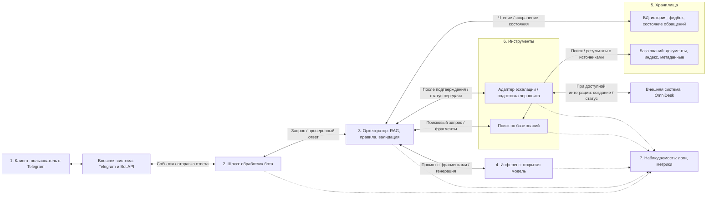

# Design doc: чат-бот поддержки по 1С:Полиграфии

Основан на шаблоне `design_doc_template.md`. Подготовлены разделы для КТ1: 1, 2, 3.1-3.4 и черновик 5.1 на 20 запросов. Дополнительно заполнены разделы 4 (проектная архитектура), 7 (риски и безопасность) и 10 (открытые вопросы).

| | |
|---|---|
| Авторы | Елизавета Гапонова, Кащеева Мария  |
| Версия |  1.0|
| Статус | черновик к КТ1 |
| Обновлен | 14.10.2026 |
| ADR | не заведены на КТ1; появятся после выбора стека |

## 1. Контекст проекта

### 1.1 Бизнес-задача

- **Проблема.** Пользователи 1С:Полиграфии задают повторяющиеся вопросы о функциях продукта, обновлениях, настройках, регламенте техподдержки и типовых ошибках. Сейчас часть таких обращений попадает к консультантам, хотя на них можно ответить по официальной документации, FAQ и регламентам.
- **Почему без LLM-системы не справиться.** Обычный поиск требует от пользователя знать правильные слова: "калькуляция", "рабочий центр", "маршрутный лист", "ИТС", "релиз". Правила и FAQ хорошо работают для точных формулировок, но хуже обрабатывают естественные вопросы, неполные описания проблемы и многошаговое уточнение. Количество обращений ежегодно растёт и бизнесу приходится тратить большие бюджеты на найм и обучение консультантов, которые перегружены работой и вопросами. Если консультант не знает ответ на вопрос, то вынужден не менее получаса искать ответ на вопрос и проверять несколько источников.
- **Почему именно это решение имеет смысл.** Чат-бот выступает первой линией: ищет ответ в официальных материалах 1С:Полиграфии, кратко объясняет, показывает источник, задает уточняющие вопросы и передает обращение человеку, когда данных недостаточно. Это снижает долю простых задач и помогает пользователю быстрее понять, что делать дальше.
- **Критерии успеха с точки зрения бизнеса.** Для пилота: не менее 35% типовых обращений закрываются без оператора; среднее время до первого полезного ответа снижается с часов/дней до секунд; доля обращений, где оператору уже передан структурированный контекст проблемы, не ниже 60%; пользовательская оценка полезности ответа не ниже 4 из 5 на пилотной выборке.

### 1.2 Пользователи и сценарии использования

- **Кто.** Клиенты 1С:Полиграфии: администраторы 1С, менеджеры типографий, сотрудники производства/склада/доставки, руководители и специалисты внедрения. Внутренний пользователь: специалисты поддержки первой линии, которые получают эскалации с уже собранным контекстом. В пилоте сервисом пользуются 15 человек.
- **Через что.** Телеграм-бот. На КТ1 считаем только текстовый чат без загрузки файлов и картинок. 
- **Нагрузка.** По данным заказчика: 15 пользователей, каждый отправляет 1-2 запроса в день. Сервис используют только в рабочие дни: итого 15-30 запросов в день и 330-660 запросов в месяц при 22 рабочих днях; средний расчетный объем при 1,5 запроса на человека в день - 495 запросов в месяц. Запросом считаем каждое сообщение пользователя, требующее ответа бота, включая уточнения. 1 RPS используем как предварительную цель нагрузочной проверки с запасом, а фактический пик уточняем по логам пилота.
- **Цена ошибки.** Неверный ответ может привести к неправильной настройке, потере времени пользователя и оператора, ухудшению доверия к поддержке. Самый рискованный класс ошибок: уверенный совет по исправлению данных рабочей базы или обновлению, если ответа нет в источниках. Поэтому бот не должен советовать прямые правки в БД, не должен выдавать неподтвержденные инструкции и должен эскалировать клиент-специфичные проблемы.
- **Что для пользователя "хорошо".** Пользователь получает понятный ответ за 10-15 секунд, видит ссылку на источник, понимает следующий шаг, не ищет вручную по сайту и не повторяет оператору всю историю, если нужна эскалация.

*Где и с кем мы общаемся.* Основной язык русский. Тон вежливый. Ответы подробные. Входные вопросы часто неполные: "не считается заказ", "где включить доставку", "как обновиться". Поэтому контракт должен поддерживать уточняющие вопросы и честный отказ, когда ответа в базе нет.

### 1.3 Границы, ограничения и допущения

**Границы системы.**

| Внутри (наш код, наши данные) | Снаружи (провайдер, внешний API, чужой сервис) |
|---|---|
| Чат-интерфейс, оркестратор, системный промпт, правила отказа и эскалации | Сайт 1cpoly.ru, OmniDesk, внешняя доступность источников |
| Индекс базы знаний: страницы продукта, FAQ, официальная документация, инструкции по обновлениям; сервис инференса выбранной открытой модели при собственном размещении | Репозиторий модели, ее лицензия и доступность вычислительных ресурсов; при внешнем размещении - сервис хостинга |
| Retrieval, ранжирование фрагментов, проверка наличия источника, формат ответа | Корректность и актуальность исходной документации |
| Логи диалогов, фидбек, eval-сет, метрики качества и задержки | Решение оператора поддержки и доступ к рабочей базе клиента |

**Что явно не делаем.**

- Не вносим изменения в базы 1С и не даем инструкции по прямому изменению данных через SQL.
- Не диагностируем клиентскую базу без логов, версии релиза, скриншотов и доступа специалиста.
- Не отвечаем на юридические, бухгалтерские и кадровые вопросы как экспертная система; можем только направить к соответствующему разделу 1С/поддержке, если он есть в базе.
- Не обрабатываем файлы, скриншоты, голос.
- Не отвечаем на вопросы вне домена 1С:Полиграфии, 1С:КП/ИТС и официальной документации.
- Консультации по методическим вопросам работы с программой
- Консультации по работе с рабочей/реальной базой данных клиента
-  Консультации по выверке данных (например, не сходятся данные результата «Расчета себестоимости» в базе данных клиента и т.д., в этом случае оказывается консультация по алгоритму работы)
-  Обучение пользователей
-  Удаленная настройка программных продуктов
-  Решение вопросов, связанных с конфигурированием программированием, тестирование и исправление баз данных, создание резервных копий.

**Допущения, которые еще не проверены.**

- О данных: официальные страницы, FAQ и инструкции достаточно покрывают минимум 60% типовых вопросов первой линии.
- О моделях: для MVP планируем использовать бесплатные модели с открытыми весами из публичных репозиториев. Конкретную модель выбираем после проверки качества ответов на русском языке и работы с найденными фрагментами документации; условия ее лицензии должны допускать планируемое использование.
- Об инфраструктуре: место запуска модели и доступное оборудование пока не выбраны. Рабочий вариант для оценки - запуск на имеющемся оборудовании команды; возможность уложиться в целевую задержку проверяем замерами. Если потребуется внешний хостинг, отдельно оцениваем стоимость и условия передачи данных.
- О безопасности и нормативах: в чат не должны попадать коммерческие данные клиента, если пользователь не дал согласие; в логах маскируются телефоны, email, ИНН, номера договоров и имена сотрудников.
- О поведении пользователей: часть пользователей будет писать неполно; бот должен чаще уточнять, чем угадывать.

*Отвечаем ли на вопросы не по предметной области(в нашем случае - официальной документации)?* Нет. Бот отвечает отказом и предлагает сформулировать вопрос о 1С:Полиграфии или обратиться в поддержку. Репутационный риск от ответа вне документации выше пользы.

## 2. Контракт сервиса

### 2.1 Контракт

| Поле | Что обещаем | Как проверим (ссылка на будущую метрику из 5.2) |
|---|---|---|
| **Вход** | Принимаем текстовые вопросы на русском языке до 2 000 символов: функциональность 1С:Полиграфии, типовые проблемы, обновления, лицензирование/ИТС, каналы и регламент поддержки. Файлы, картинки и голосовое сообщение в MVP не принимаем. | `input_validity`, `out_of_domain_refusal`, ручная проверка eval-сета |
| **Выход** | Возвращаем краткий ответ на русском, 3-8 предложений, с минимум одной ссылкой/названием источника, если ответ найден в базе. Для инструкций даем безопасные шаги только из источников. | `groundedness`, `source_required`, `answer_helpfulness` |
| **Поведение при неуверенности** | Если retrieval не нашел надежных фрагментов или вопрос клиент-специфичен, бот говорит, что точного ответа нет, задает уточняющие вопросы или предлагает передачу консультанту. | `correct_refusal`, `clarification_quality`, `handoff_precision` |
| **Чего не обещаем** | Не гарантируем отсутствие ошибок; не заменяем специалиста 1С; не даем юридически значимые консультации; не исправляем рабочую базу; не отвечаем по доработанным конфигурациям без участия консультанта. | Дисклеймер в интерфейсе, негативные примеры в eval |
| **Нефункциональные** | TTFT P95 <= 2 с при стриминге; полный ответ P95 <= 15 с; доступность MVP 99%; персональные данные маскируются в логах; история хранится 90 дней в пилоте. | Трейсы, логи, парсер персональных данных, мониторинг |

**Контракт одной фразой:**

> На вопрос на русском о 1С:Полиграфии бот возвращает краткий ответ, опирающийся минимум на один фрагмент официальной базы знаний, и показывает источник; если надежного фрагмента нет или нужна диагностика рабочей базы, бот явно говорит об этом, уточняет данные или передает оператору; TTFT P95 <= 2 с, полный ответ P95 <= 15 с, вне официальной документации не отвечает.

### 2.2 Сценарии взаимодействия

**Основные сценарии.**

| Сценарий | Пример запроса | Что делает система | Результат для пользователя |
|---|---|---|---|
| Поиск ответа по базе | "Можно ли в 1С:Полиграфии вести склад материалов и готовой продукции?" | Нормализует вопрос, ищет в индексе, находит фрагмент про склад, формирует ответ со ссылкой | Пользователь получает подтверждение и понимает, где искать функцию |
| Уточняющий вопрос | "Не считается заказ, что делать?" | Определяет, что вопрос недостаточно конкретный; спрашивает тип заказа, этап, текст ошибки, релиз | Пользователь понимает, какие данные нужны для решения |
| Эскалация в поддержку | "После обновления ошибка в рабочей базе, нужен специалист" | Собирает релиз, конфигурацию, текст ошибки, контакт/номер клиента; создает или подготавливает задачу для консультанта    | Консультант получает структурированное обращение, пользователь не повторяет контекст |

**Исключительные сценарии.**

| Ситуация | Поведение системы | Что видит пользователь |
|---|---|---|
| Ответа нет в базе | Не выдумывает; сообщает, что не нашел подтвержденный ответ; предлагает уточнить или передать оператору | "В базе знаний нет надежного ответа по этому случаю. Уточните релиз и текст ошибки или передам вопрос специалисту." |
| Не поняли запрос | Один раз задает уточняющий вопрос с вариантами домена: калькуляция, склад, производство, доставка, обновление, лицензии | "Уточните, о какой функции идет речь." |
| Запрос вне домена / попытка вывести за контракт | Отказывает и не вызывает генерацию доменного ответа | "Я отвечаю только по 1С:Полиграфии и официальной документации." |
| Инструмент не ответил / вернул ошибку | Использует статический fallback; иначе просит повторить позже | "Сейчас не могу проверить базу знаний. Попробуйте позже или обратитесь к консультанту." |
| Модель вернула невалидный формат или зациклилась | Один retry с жесткой схемой(JSON data schema); затем безопасный отказ и лог `needs_review` | "Не удалось подготовить надежный ответ. Передам обращение консультанту." |
| Нужен человек: передача оператору | Собирает обязательные поля и создает задачу/черновик задачи   | "Передаю специалисту: релиз, описание проблемы и ваши контакты сохранены в обращении." |

### 2.3 Диалоговая логика и тон

- **Single-turn или multi-turn.** Multi-turn в рамках одной сессии: бот может задавать уточняющие вопросы и помнить последние сообщения. Каждый ответ должен быть проверяем как отдельное событие с источниками.
- **История диалога.** История хранится в БД приложения: `sessions`, `messages`, `retrieval_events`, `handoff_requests`. В промпт попадают системные инструкции, последние 6 сообщений сессии или до 2 000 токенов, найденные фрагменты базы знаний и состояние эскалации. Обрезка истории идет по релевантности и времени, а не просто по последним токенам.
- **Долгая память о пользователе.** В MVP нет долгой персональной памяти о пользователе между сессиями, кроме номера обращения и технического контекста в OmniDesk при согласии пользователя. Для авторизованного личного кабинета можно хранить историю обращений, но это решение после КТ1.
- **Тон и стиль.** Русский язык, вежливо и делово, без эмодзи. Ответы короткие: сначала прямой ответ, затем источник, затем следующий шаг. Не используем уверенные формулировки там, где нужен оператор: "вероятно", "нужно проверить", "передайте специалисту".
- **Прозрачность.** Первый экран сообщает: "Это чат-бот первой линии. Он отвечает по базе знаний и может ошибаться; для сложных случаев передаст обращение консультанту. Не отправляйте коммерческие данные без необходимости."

## 3. Три бюджета и SLO

### 3.1 Качество

| Метрика (из контракта) | Как считаем | Целевое значение | Ниже чего - откат |
|---|---|---:|---:|
| Доля ответов с релевантным источником | Человек или judge проверяет, что источник действительно подтверждает ответ | >= 90% | < 82% |
| Groundedness: нет фактов вне источников | Judge + ручная проверка 50 примеров | >= 92% | < 85% |
| Доля корректных отказов вне домена | Eval-сет вне базы знаний и prompt-injection | >= 95% | < 90% |
| Качество уточняющих вопросов | На неоднозначных запросах бот задает нужный уточняющий вопрос, а не угадывает | >= 85% | < 75% |
| Доля корректных эскалаций | На клиент-специфичных/опасных проблемах бот предлагает консультанта | >= 90% | < 82% |
| Валидность формата ответа | Ответ содержит прямой ответ, источник или честный отказ, следующий шаг | >= 98% | < 95% |
| Пользовательская полезность | 👍/👎 после ответа | >= 4,0/5 в пилоте | < 3,6/5 |

В таблице представлены предварительные целевые значения; уточняются после тестирования и согласования с консультантами.

### 3.2 Задержка

Типичный запрос: пользователь пишет вопрос, оркестратор делает retrieval по базе знаний, собирает промпт с 4-6 фрагментами, вызывает модель, валидирует ответ и стримит его пользователю.

| Этап | Оценка, мс | Откуда число |
|---|---:|---|
| Сеть + шлюз | Уточняется замером | Доставка сообщений Telegram, обработка ботом и обращение к сервису инференса |
| Retrieval | Уточняется замером | Поиск по индексу базы знаний и выбор 4-6 фрагментов |
| Prefill | Уточняется после выбора модели и оборудования | Обработка промпта ориентировочно на 3 500 токенов; учитываем очередь запросов |
| Decode (N токенов x TPOT) | Уточняется после выбора модели и оборудования | Ориентир N = 350 выходных токенов; TPOT измеряем на выбранной конфигурации |
| Инструменты | Уточняется замером | Валидация, сохранение логов, сбор источников |
| Число вызовов модели | 1 в основном сценарии, до 2 при retry | Повторный вызов только при невалидном формате; уточнение пользователя - отдельный запрос |
| **Итого e2e, P50 / P95** | **Пока не измерено; цель P95 <= 15 с** | Проверяем на выбранной модели и оборудовании при нагрузке пилота |

Предварительные целевые значения: TTFT P95 <= 2 с на сервисе инференса, e2e P95 <= 15 с до доставки полного ответа в Telegram. Возможность постепенного обновления ответа в Telegram проверяем при реализации. Для отказов и уточняющих вопросов целевой e2e P95 <= 5 с. Эти значения являются целями, а не результатами измерений: достижимость зависит от выбранной открытой модели, оборудования, длины контекста и очереди запросов.

### 3.3 Стоимость

Для MVP используем бесплатную модель с открытыми весами из публичного репозитория. Платные вызовы коммерческих LLM API в базовый план MVP не входят. Конкретная модель пока не выбрана: сравниваем кандидатов по качеству на eval-сете, поддержке русского языка, требованиям к памяти и скорости на доступном оборудовании.

Бесплатные веса модели не означают нулевую стоимость работы сервиса. Бюджет зависит от места запуска, электроэнергии, хранения данных и обслуживания.

Формулы для собственного размещения:

```text
requests_per_month = 15 x (1-2) x 22 = 330-660
cost_per_month = compute + electricity + storage_and_hosting + maintenance
average_cost_per_request = cost_per_month / requests_per_month
```

| Параметр | Значение | Откуда |
|---|---:|---|
| `tokens_in` на запрос | 3 500 | Системный промпт 700 + история 500 + 4-6 retrieved-фрагментов 2 000 + вопрос и служебные поля 300 |
| `tokens_out` на запрос | 350 | Краткий ответ 3-8 предложений, источник, следующий шаг |
| Вызовов модели на запрос | 1 в основном сценарии, до 2 при retry | Частоту повторных вызовов измеряем в пилоте |
| Плата за веса модели и токены | 0 при собственном запуске выбранной бесплатной модели | Условие выбора модели для MVP; затраты на вычисления учитываются отдельно |
| `requests_per_month` | 330-660; среднее 495 | 15 пользователей x 1-2 запроса в день x 22 рабочих дня |
| Вычислительные ресурсы | Уточняется | На имеющемся оборудовании дополнительная аренда может не понадобиться; при аренде учитываем тариф и время работы |
| Электроэнергия | Уточняется | Потребление оборудования x часы работы x тариф; учитываем также простой |
| Retrieval, хранение и хостинг бота | Уточняется | Размещение индекса, БД, логов и Telegram-бота; первичная индексация считается отдельно |
| **average_cost_per_request** | **Уточняется после выбора инфраструктуры** | Месячные расходы / 330-660 запросов |
| **cost_per_month** | **Пока не определена; плата за модель - 0** | Сумма расходов на запуск и обслуживание; бесплатный запуск возможен, если все необходимые ресурсы уже доступны без дополнительных платежей |

Скрытая стоимость: подготовка и чистка базы знаний; разметка eval-сета двумя людьми; ревью сложных ответов консультантом 1С; настройка логирования и маскирования персональных данных; установка и обновление модели. Труд команды оцениваем отдельно от денежных расходов на инфраструктуру.

Перед фиксацией бюджета нужно определить модель, оборудование, режим работы сервиса и способ размещения бота. Для небольшой нагрузки пилота сначала проверяем запуск на доступных ресурсах команды. Если их не хватает для целевого качества и задержки, пересчитываем бюджет.

### 3.4 Компромисс

Главный бюджет для MVP - качество и безопасность ответа, а не минимальная задержка. Пользователю поддержки лучше получить честный отказ или эскалацию, чем быстрый, но выдуманный совет по рабочей базе. Поэтому выбираем RAG с обязательным источником, строгие правила отказа и эскалации. Для MVP используем бесплатные модели с открытыми весами; расходы на их запуск ограничиваем выбором модели, подходящей для доступного оборудования, ограничением top-k и отсутствием агентного многошагового цикла. Готовы жертвовать скоростью на сложных обращениях, но не groundedness и корректными отказами. Если модель не проходит проверку качества, сравниваем другие открытые модели и дорабатываем retrieval и промпт до допуска в пилот.

## 4. Архитектура решения

### 4.1 Схема по семи блокам

Предварительная архитектура MVP: фиксированный RAG-пайплайн с бесплатной моделью с открытыми весами. Конкретный стек и место запуска выбираем после проверки доступного оборудования. Семь блоков обозначают логические обязанности, а не семь отдельных серверов: шлюз, оркестратор и инструменты могут работать в одном приложении. Сплошные двунаправленные связи показывают вызов и возврат результата, пунктир - передачу обезличенной телеметрии. Порядок выполнения показан отдельно в 4.2.



Оркестратор читает историю из БД, а документы получает через поисковый инструмент. Модель генерации получает выбранные фрагменты в промпте; самостоятельно к БД, индексу, Telegram и OmniDesk она не обращается. Подготовка индекса выполняется отдельным процессом, описанным в 4.3. Наблюдаемость получает события от компонентов и не является обязательным промежуточным шагом доставки ответа; пользовательский фидбек сохраняется в БД и учитывается в метриках.

Telegram Bot API - внешняя граница доставки: события получаем одним выбранным способом, через polling или webhook, а ответы отправляем отдельным вызовом API. Для OmniDesk предусмотрен адаптер создания обращения; возможность подключить его в аккаунте проекта еще не подтверждена. Схема отражает проектное решение, а не уже работающую интеграцию.

| Блок | Что делает в нашей системе | Берем готовое | Пишем сами и почему |
|---|---|---|---|
| Клиент | Принимает вопросы и показывает ответ, источники, кнопки оценки и передачи консультанту | Приложение Telegram | Тексты сообщений и кнопок под сценарии поддержки 1С:Полиграфии |
| Шлюз | Получает события через Telegram Bot API, проверяет доступ и лимит 2 000 символов, предотвращает повторную обработку, отправляет готовый ответ | Готовую библиотеку для ботов; Telegram Bot API остается внешним интерфейсом | Правила доступа для 15 участников пилота, обработку ошибок и ограничение очереди |
| Оркестратор | Загружает историю, вызывает поиск, собирает промпт, проверяет ответ, выбирает уточнение или эскалацию | Готовые библиотеки работы с моделями и проверки схем | Последовательность шагов и правила домена; один вызов модели, максимум один retry |
| Движок инференса | Запускает выбранную бесплатную модель с открытыми весами | Готовый движок запуска, подходящий для выбранного оборудования | Конфигурацию запуска и ограничения контекста; собственный движок не требуется |
| Хранилища | Хранят документы, поисковый индекс, историю сессий, фидбек и состояние обращений | Готовую БД и поисковый индекс; конкретный выбор открыт | Схему данных и метаданные документации, связанные с релизами 1С:Полиграфии |
| Инструменты | Ищут фрагменты документации и подготавливают обращение консультанту | Поисковую библиотеку и интерфейс OmniDesk после проверки доступа | Адаптер передачи технического контекста; до интеграции - подготовку черновика обращения |
| Наблюдаемость | Собирает задержку, ошибки, использованные источники, версию модели и оценку ответа | Готовые средства логирования и метрик | События, специфичные для качества поддержки, и маскирование чувствительных полей |


## 5. Eval-план

### 5.1 Eval-сет

| | |
|---|---|
| Размер | 20 примеров для КТ1 |
| Откуда примеры | Придуманные по сценариям из 2.2 на основе официальной страницы продукта, FAQ и регламента техподдержки; перед КТ2 нужно заменить часть примеров реальными обезличенными обращениями |
| Где лежит |  |
| Покрытие | Штатные вопросы по функциям продукта, поддержка/регламент, уточнения, отсутствие ответа в базе, вне домена, prompt injection, сбой retrieval, передача оператору |
| Кто и как разметил | Черновая разметка авторами проекта; для КТ2 нужна проверка человеком, знакомым с 1С:Полиграфией |
| Как пополняется | Из прод/пилота: 👎, эскалации, вопросы без найденного источника, исправления консультанта, новые FAQ, из базы обращений    |

Доли по типам: 50% штатных вопросов по продукту и поддержке, 15% вопросов без ответа/клиент-специфичных, 10% неоднозначных запросов с уточнением, 15% вне домена и безопасные отказы, 10% технические сбои/эскалации/контракт на источники.

## 7. Риски, ограничения, безопасность

### 7.1 Структурные ограничения модели и чем закрываем

| Ограничение | Касается нас? | Чем закрываем |
|---|---|---|
| Арифметика и подсчеты | Да, вопросы о калькуляции и себестоимости | Бот объясняет документированный порядок действий; точные расчеты по данным клиента передает консультанту и самой системе 1С |
| Факты вне контекста | Да | Retrieval по официальным материалам, привязка к релизу и источники в ответе |
| Не знает, чего не знает | Да | Проверка наличия релевантных фрагментов, уточнение или отказ; оценку уверенности модели не считаем достаточным основанием |
| Консистентность между запросами | Да | Общие правила оркестратора, фиксированные версии промпта и модели, сохранение технического контекста в сессии |
| Длинные планы без проверок | Ограниченно | Фиксированный пайплайн, один вызов и максимум один retry; никаких самостоятельных изменений в базе клиента |
| Нет состояния между вызовами | Да | История и состояние обращения в БД приложения, загрузка через оркестратор |
| Недетерминизм | Да | Низкая temperature и повторные прогоны неоднозначных и опасных сценариев перед релизом |
| Уверенная выдумка инструкций, объектов и команд | Да | Проверка ссылок кодом, ручная оценка фактов консультантом, негативные примеры в eval и отказ при недостатке документации |

### 7.2 Риски проекта

| Риск | Вероятность | Последствия | Что делаем |
|---|---|---|---|
| База не покрывает реальные технические вопросы | Низкая | Частые отказы и низкая полезность | Проверяем покрытие на реальных обезличенных обращениях; согласуем источники с консультантом |
| Устаревшая инструкция или смешение релизов | Средняя | Неверные рекомендации | Метаданные версии, уточнение релиза, обновление и исключение конфликтующих материалов |
| Открытая модель не проходит требования по качеству | Средняя | Выдумки и неправильные отказы | Сравниваем кандидатов на одном eval-сете; дорабатываем поиск и промпт, не допускаем непроверенную модель в пилот |
| Оборудования не хватает для целевой задержки | Средняя, оборудование неизвестно | Долгое ожидание и очередь | Замеряем память и скорость; подбираем размер модели и квантование, пересматриваем размещение и бюджет |
| Telegram, инференс или OmniDesk недоступны | Средняя | Ответ или передача не состоялись | Тайм-ауты, ограниченные повторы, контроль дублей и черновик обращения; сообщаем только подтвержденный статус |
| Обновление модели, промпта или индекса снижает качество | Средняя | Регрессия ранее работавших сценариев | Фиксируем версии, прогоняем eval, сохраняем комплект для отката |
| Чувствительные сведения попадают в логи или внешние системы |  Низкая| Раскрытие данных клиента | Минимизация и маскирование данных, ограничение доступа, явное подтверждение передачи контактов |
| Prompt injection из вопроса или документа | Средняя | Выход за домен, раскрытие правил или опасные инструкции | Отделяем инструкции от данных, разрешаем только заданные действия, проверяем негативные сценарии |
| Сет из 20 примеров не отражает реальные обращения | Низкая | Завышенная оценка качества | Используем его для проверки сценариев; расширяем реальными примерами и указываем число проверок для каждой метрики |
| Недостаточно времени команды или участия консультанта | Средняя | Задержка пилота и непроверенные ответы | Ограничиваем MVP текстом и фиксированным пайплайном; заранее назначаем ревью документации и eval |

Ключевые непроверенные допущения из 1.3: покрытие типовых вопросов документацией, достаточность оборудования и качество бесплатной модели. Проверяем их до обещания сроков ответа и допуска пользователей в пилот.

## 10. Открытые вопросы

Предлагаемое распределение ответственности приведено по ролям; закрепление ролей за Елизаветой Гапоновой и Марией Кащеевой еще требуется согласовать. Сроки указаны относительно этапов проекта, поскольку календарные даты КТ2 и пилота пока не заданы.

| Вопрос | Предлагаемый владелец | Срок решения | Статус |
|---|---|---|---|
| Какую бесплатную модель и ревизию весов выбрать по качеству русского языка, RAG и отказов? | Участник команды, ответственный за модель | До фиксации стека на КТ2 | Открыт; требуется сравнение |
| Где запускаем модель, сколько доступно RAM/VRAM и достигаются ли TTFT <= 2 с и полный ответ <= 15 с? | Участник команды, ответственный за инфраструктуру | До фиксации бюджета на КТ2 | Открыт; требуется инвентаризация и замер |
| |
| Какой поиск, эмбеддинги, размер фрагментов и порог релевантности дают лучшие результаты? | Ответственный за retrieval | До проверки RAG на КТ2 | Открыт; требуется eval |
|  |
|  |
| Кто разметит реальные обращения и какие цели качества и пороги отката принимаем? | Ответственный за eval совместно с консультантом | До допуска в пилот | Открыт; текущие проценты предварительные |
|  |
|  |
| Какой предел расходов на инфраструктуру приемлем и кто поддерживает сервис при сбое? | Команда проекта совместно с заказчиком пилота | До размещения сервиса | Открыт; требуется бюджет и назначение ответственного |

## Источники для КТ1

- Официальная страница продукта: https://1cpoly.ru/poligrafiy2/
- FAQ: https://1cpoly.ru/questions/
- Регламент технической поддержки: https://1cpoly.ru/tech-support/techsup/
- Техническая поддержка: https://1cpoly.ru/tech-support/

## История изменений

| Дата | Версия | Что изменилось | Почему |
|---|---|---|---|
| 14.10.2026 |  1.0| Заполнены разделы 1, 2, 3.1-3.4 и черновик 4, 5, 7; создан eval-сет на 20 запросов | КТ1 |
| 