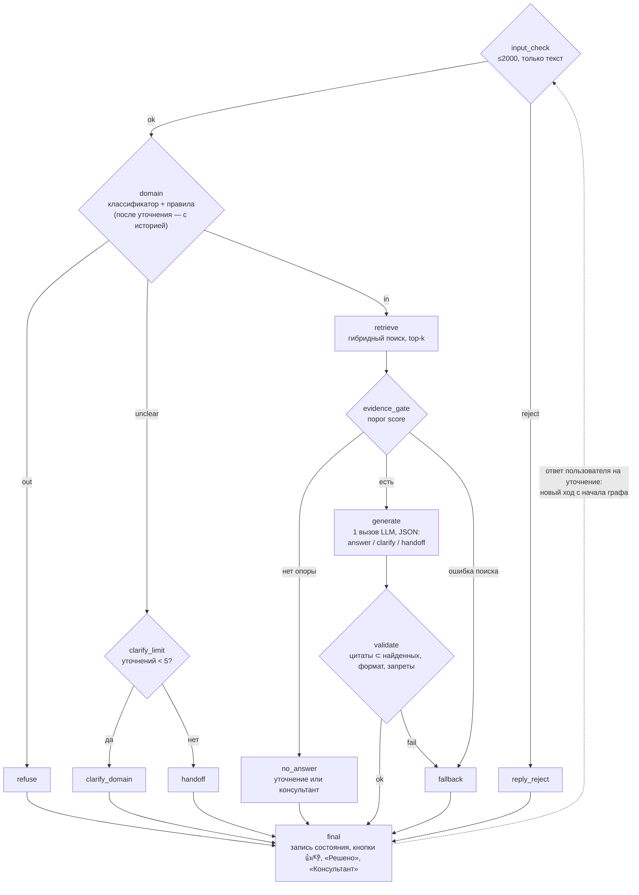

# План: RAG-бот поддержки 1С:Полиграфии в Telegram

Черновик плана от 16.11.2026. Исходные материалы:
- наш design doc (КТ2);
- `domain_classifier/`, `s0_baseline/`, `knowledge base/`;
- два внешних проекта:
  - [xufana/08week_observability](https://github.com/xufana/llm-system-engineering/tree/main/08week_observability) — дальше «08week»;
  - [RajdeepDas43/RAG-Powered-LLM-Chatbot](https://github.com/RajdeepDas43/RAG-Powered-LLM-Chatbot) — дальше «Rajdeep».

Сроки по `project.md`:
- КТ3 — 22.11 (перенесена с 15.11);
- КТ4 — 06.12.

Eval-набор не открываем до КТ4: вся разработка и настройка идёт только на dev.

---

## 1. Что берём, что не берём

### Из 08week — каркас сервиса и наблюдаемость

| Берём | Зачем нам | Что меняем |
|---|---|---|
| Граф узлов `Node`/`Graph` с проверкой переходов и путей + `Orchestrator` с `max_steps` | Явный и проверяемый пайплайн (раздел 4). Бюджет шагов — прямое требование КТ3 | При исчерпании шагов — **fallback-шаблон** «передам консультанту», а не исключение. Сообщение об ошибке — типизированное, а не «что-то пошло не так» |
| `BaseNode.execute()`: span Langfuse + Prometheus (`node_execution_total`, `duration`, `decision_total`) | КТ4: «один запрос = один трейс с иерархией шагов» | Исправить: `decision_total` без `registry` не попадает в `/metrics`. Добавить в span версию промпта, токены, id чанков, прочитанное и записанное состояние |
| `clients/llm.py`: OpenAI-совместимый клиент + наблюдение `generation` в Langfuse | Подходит для открытой модели через vLLM или Ollama (C12: без платных API) | Добавить таймаут, 1 ретрай, подсчёт токенов и стоимости (по 3.3 — электричество на запрос) |
| Промпты в Langfuse с версиями (`get_prompt`) | Воспроизводимость прогонов: версия промпта фиксируется в метаданных | Запасной вариант — промпты в git, `prompts/*.txt` + sha256, если Langfuse недоступен |
| Решения узлов через `response_format=json_schema` + `DecisionScheme` | Структурированный ответ LLM: тип (ответ / уточнение / передача) + id цитируемых чанков | — |
| `pydantic-settings`, `.env`, docker-compose (Qdrant, Prometheus, Grafana), uv, ruff, pre-commit | Воспроизводимая инфраструктура | Добавить self-hosted **Langfuse** в compose (тексты обращений клиентов не должны уходить в облако, C08) — это ADR |
| Логи с `session_id` через contextvar | Основа для «логи с id трейса» (КТ4) | JSON-логи, `trace_id`, маскирование ПДн **до** записи |
| Prometheus middleware на HTTP | Латентность e2e | Плюс метрики Telegram-уровня: e2e до отправки, TTFT при стриминге |

**Не берём из 08week:**
- узел-агент с калькулятором: агентный цикл исключён в 3.4;
- LLM-роутер типа диалога: вместо него наш измеренный классификатор домена — быстрее, детерминирован, проверен на dev;
- болталку для user/admin;
- узел `harmful`: грубость и injection закрываем отказом или правилами.

### Из Rajdeep — работа с документами

| Берём | Зачем нам | Как делаем у себя |
|---|---|---|
| Отдельный процесс индексации: загрузка → чанкинг → эмбеддинги → векторная БД | В design doc индекс строится отдельным процессом | `ingest/build_index.py` с версией индекса (sha документов + параметры чанкинга) |
| Чанкинг с перекрытием (`RecursiveCharacterTextSplitter`) | Руководство «1С УНФ 8 Полиграфия 2 для 3.0» (20 МБ, `.doc`) не поместится одним куском | Режем **по заголовкам** и только длинные разделы — по символам. В метаданные пишем путь заголовков, продукт и релиз |
| `return_source_documents` — источники рядом с ответом | C03: источник обязателен | Источник = URL FAQ или раздел руководства; бот показывает название и ссылку |
| LLM-судья «есть ли в чанке ответ на вопрос» (0/1) | Офлайн-оценка релевантности retrieval (близко к M02) | Только в харнессе и офлайн на открытой модели. В рантайме нельзя: правило «1 вызов LLM на сообщение» |
| OCR сканов | — | **Не сейчас.** Картинки FAQ пропускаем (`ocr_status: not_performed`); вернёмся, если разбор провалов покажет, что ответ был на скриншоте |

**Не берём из Rajdeep:**
- Streamlit;
- `ConversationalRetrievalChain`: скрытая логика, память, которая теряется при каждом ререндере, хак `split("Helpful Answer:")`;
- FAISS в pickle;
- HuggingFaceHub с base-моделью.

### Своё, что уже есть и встраивается как узлы

| Компонент | Роль в новом боте |
|---|---|
| `domain_classifier` (in / unclear / out + правила R1–R4) | Первый узел маршрутизации, вместо LLM-роутера из 08week |
| `S0Bot` | **Только baseline** в харнессе: тот же интерфейс `respond()`, тот же набор. В MVP-боте код S0 не используется, в том числе правила `client_specific` |
| `knowledge base/*.jsonl` (100 FAQ) + `.doc` руководство | Корпус индекса |
| `omnidesk_cases.jsonl` (1423 обращения) | **Не источник фактов** (неофициальные ответы, ПДн). Используем для покрытия тем и сценариев dev. Решение — в ADR |

---

## 2. Целевой граф бота



- **`generate`** возвращает JSON: `{"type": "answer"|"clarify"|"handoff", "text": ..., "cited_chunk_ids": [...]}`.
- **`validate`** проверяет кодом:
  - каждый id из `cited_chunk_ids` есть среди найденных чанков;
  - у `answer` есть хотя бы один источник;
  - в ответе нет SQL и советов править базу (C07);
  - тон проверяется регулярками: эмодзи, обещания создать заявку (C06, C10).

  Проверка не прошла → готовый шаблон без повторной генерации (2.2).
- **`unclear` → уточняем, а не отказываем** (C04, C05). Бот спрашивает, относится ли вопрос к 1С:Полиграфии и о какой функции речь, и ход заканчивается. Ответ пользователя — новый запуск графа с начала, `input_check` → `domain`. Если в состоянии стоит `pending_clarification = domain`, классификатор оценивает ответ вместе с предыдущими сообщениями пользователя (`history` в `domain_classifier`). Дальше маршрут зависит от **нового** решения:
  - `in` → обычный путь `retrieve` → `evidence_gate` → `generate`. Поисковый запрос — исходный вопрос + уточнение, а не только ответ пользователя: на «да, в заказе» искать нечего;
  - `out` → `refuse`;
  - снова `unclear` → следующее уточнение, если лимит не исчерпан.

  То же для `clarify` от `generate`: ответ пользователя идёт по графу заново, домен определяется с учётом истории.
- **Лимит уточнений — один на обращение, до 5** (C04, 2.3). Счётчик `clarifications` в состоянии обращения общий для всех уточнений:
  - `clarify_domain` — неясно, к домену ли вопрос;
  - `clarify` от `generate` — вопрос в домене, но неполный;
  - уточнение в `no_answer`.

  Когда 5 уточнений исчерпаны, шестого нет: узел `clarify_limit` и `validate` переводят ответ в `handoff`.
- **Клиент-специфичный случай** («после обновления ошибка в нашей базе», доработанная конфигурация) определяет `generate`: в системном промпте есть правило, LLM возвращает `type: handoff`. Отдельного узла с правилами S0 нет. Если доля таких ошибок на dev окажется высокой, добавим собственный узел с правилами перед `retrieve` и решение по нему оформим в ADR.
- **Бюджет шагов:** самый длинный путь — 7 узлов, `max_steps = 10`. Исчерпание → `fallback`, событие `budget_exhausted` в трейсе.

---

## 3. Стек

| Слой | Выбор | Почему / альтернатива |
|---|---|---|
| Telegram | `aiogram 3`, long polling | Пилоту на 15 человек вебхук и публичный адрес не нужны. Whitelist id участников |
| Сервис | FastAPI: `/chat` (для харнесса), `/metrics`, `/health` | Telegram-обработчик и харнесс вызывают одну функцию `Bot.respond()` |
| LLM | Открытая модель через API **Yandex AI Studio** (OpenAI-совместимый), на время курса — стартовый грант 4 000 ₽ | Кандидат — Qwen3.6 35B (`qwen3.6-35b-a3b`, 0,2 / 0,3 ₽ за 1000 токенов). Ноутбук без GPU не тянет P95 ≤ 15 с, GPU на reg.ru — 8–28 тыс. ₽/мес. Собственный запуск (vLLM) остаётся на будущее: меняется только `.env`. ADR — выбор модели и провайдера |
| Эмбеддинги | `multilingual-e5-base` или `bge-m3` (открытые, CPU) | В S0 MiniLM давал 0.62 top-1, лемматизированный TF-IDF помогал, отсюда гибридный поиск |
| Поиск | Qdrant: dense + sparse (BM25 по леммам pymorphy3), слияние RRF | Опционально реранкер `bge-reranker-v2-m3`, если recall@5 на dev низкий |
| Состояние | SQLite (`sessions`, `messages`, `retrieval_events`, `handoff_requests`) | Таблицы из 2.3; на 15 пользователей Postgres не нужен |
| Трейсинг | Langfuse self-hosted (поверх OTel) | ADR: Langfuse vs Phoenix. Langfuse уже в 08week, плюс управление промптами |
| Метрики | Prometheus + Grafana | Из 08week как есть |

---

## 4. Память и состояние (раздел 6 design doc)

| Тип | Где живёт | Срок | Что попадает в контекст LLM |
|---|---|---|---|
| Рабочее состояние обращения: счётчик уточнений, статус передачи, согласие | SQLite `sessions` | До «Проблема решена», `/new` или 24 ч тишины | Счётчик и статус — одной строкой в системном промпте |
| Эпизодическая: сообщения | SQLite `messages` | 90 дней (C08) | Последние 4 реплики текущего обращения, каждая ≤ 500 символов |
| Факты о продукте | Индекс Qdrant (версионирован) | До переиндексации | 4–6 чанков |
| Кэш эмбеддингов запросов | В памяти, LRU | До перезапуска | — |

- **Бюджет контекста:** системный промпт ~700 + чанки ~2000 + история ~600 + вопрос ~300 токенов.
- **При переполнении режем в таком порядке:** сначала история (старые реплики), затем число чанков (с 6 до 4). Системный промпт не режется.
- **Долгой памяти о пользователе нет** (2.3). Поэтому вопросы КТ3 про противоречия фактов и отравление памяти касаются только индекса: у документа есть релиз и `content_sha256`, конфликтующие версии исключаются при индексации.

---

## 5. Харнесс (КТ3, раздел 5)

- **Один вход для обеих систем:**

  ```bash
  python -m harness.run --system s0|rag --set dev [--repeat 3]
  ```

  Обе системы реализуют `respond(message, history) -> Response(type, text, sources, steps, tokens, latency)`.
- **Метаданные каждого прогона:**
  - git sha;
  - модель и её ревизия;
  - версии промптов;
  - temperature и seed;
  - sha набора и версия индекса.

  Сохраняются в `harness/results/<run_id>/meta.json` рядом с `cases.jsonl` и `summary.json`.
- **Считаем стоимость и длительность:**
  - токены in/out;
  - e2e по каждому кейсу;
  - P50 и P95;
  - стоимость в рублях по формуле 3.3.
- **Контракты инструментов:**

  | Инструмент | Таймаут | Ретраи | При ошибке возвращает |
  |---|---|---|---|
  | `retrieve` | 3 с | 1 | `ToolError(kind=timeout\|unavailable)` → узел `fallback` |
  | `llm` | 20 с | 1 | `ToolError` → узел `fallback` |
  | `handoff` | — | — | Всегда `draft` при `INTEGRATION_CONFIRMED = False` |

- **Многошаговые сценарии** (`harness/scenarios/*.yaml`, проигрываются как диалог):
  1. Уточнение → ответ: «не считается заказ» → «тип заказа?» → «листовая продукция» → ответ с источником. Второй шаг зависит от первого.
  2. Qdrant недоступен посередине диалога (инъекция ошибки через флаг) → fallback, после восстановления — нормальный ответ.
  3. Пользователь 6 раз отвечает неинформативно → на 5-м уточнении предложение консультанта.
  4. Пользователь меняет вводные: «в Полиграфии 2… а нет, у нас модуль для ERP» → ответ по другому продукту, источник другой редакции.
  5. Посреди диалога посторонний вопрос → отказ, затем возврат к теме без потери контекста.
  6. Эскалация: согласие → отмена согласия → данные не передаются.
  7. Prompt injection внутри доменного вопроса.

---

## 6. Наблюдаемость (КТ4, раздел 9)

- **Трейс:** один запрос = один трейс в Langfuse.
  - Корень: `session_id`, `user_hash`, длина входа.
  - Span каждого узла: вход и выход, решение.
  - `retrieve`: id чанков, score и источник.
  - `generate`: модель, версия промпта, токены, латентность, стоимость.
  - `final`: что записано в состояние.
- **Самопроверка:** спрятать финальный ответ и по полям трейса предсказать, был ли прогон удачным.
- **Дашборд Grafana:**
  - P50/P95 e2e и TTFT;
  - стоимость на запрос;
  - доля отказов, уточнений и эскалаций;
  - доля ошибок инструментов;
  - число шагов на запрос (среднее и хвост);
  - доля `validate=fail`;
  - 👍/👎.
- **Логи:** JSON с `trace_id`. Телефоны, email, ИНН и номера договоров маскируются регулярками до записи в лог и до отправки в Langfuse (C08).
- **Реплей:** ответы LLM и поиска пишутся в трейс. `harness.replay --trace <id>` переигрывает путь на записанных ответах без вызова модели.
- **Разбор трёх провалов** — после прогона на полном наборе, на КТ4.

---

## 7. Этапы и порядок

КТ3 сдвинута на 22.11, поэтому на неё остаётся 6 дней. На КТ3 делаем только то, что она требует:
- воспроизводимый прогон через харнесс;
- многошаговые сценарии;
- измеренный baseline;
- разделы 4, 5, 6, 8, 9 (план) и ADR.

Система для сравнения с S0 к этой дате — минимальный RAG по 100 статьям FAQ. Telegram-бот подключается тонкой обёрткой над тем же `Bot.respond()`, что вызывает харнесс. Всё остальное переносится на КТ4.

### КТ3 — до 22.11

Актуальное состояние и распределение оставшейся работы между Марией и Елизаветой — в [handoff_context.md](handoff_context.md), раздел 7.

| # | Даты | Что сделано в конце | Критерий перехода |
|---|---|---|---|
| 0 | 16–17.11 | Каркас `bot/` из 08week с исправленными багами: граф, `BaseNode`, оркестратор с бюджетом шагов, LLM-клиент, settings. Qdrant в compose. LLM — API Yandex AI Studio, проверка `python -m polybot.check_llm` | `Bot.respond("…")` проходит граф до `final` |
| 1 | 17–18.11 | `ingest/`: FAQ + лицензии + руководство (`.docx`) + OmniDesk → Qdrant, гибридный поиск с квотой OmniDesk. Recall@5 и MRR на dev. **Сделано 18.11:** FAQ-перефразы hit@5 95%, руководство 62% (`handoff_context.md`, раздел 4) | Recall@5 ≥ top-1 у S0 (0.76) — выполнено |
| 2 | 18–20.11 | Узлы `generate` + `validate`, состояние в SQLite (счётчик уточнений). Харнесс: один вход для S0 и RAG, `meta.json`, токены, время, стоимость. Контракты инструментов, инъекция ошибки поиска. 7 сценариев в YAML | Все 7 сценариев прогоняются командой `harness.run --scenarios` |
| 3 | 20–21.11 | Прогон S0 и RAG на **dev** с метаданными. **Telegram-бот** (`aiogram 3`, long polling, токен из `.env`): whitelist id участников; проверка «только текст, ≤ 2000 символов»; `session_id = chat_id`; ответ с источниками; кнопки 👍/👎, «Проблема решена», «Консультант» пишут события в SQLite. ADR: граф с RAG против интентов и против LangChain-цепочки. Разделы design doc 4, 5, 6, 8 (измерен), 9 (план), 11 | Числа S0 и RAG на dev (M17 вместе с M03/M06), P50/P95. Сценарии 1, 3, 5 проходят вручную в Telegram |
| — | 22.11 | Буфер, PR | Сдача КТ3 |

На КТ3 **не делаем**:
- Langfuse, Prometheus и Grafana — только план в разделе 9, но `BaseNode` сразу пишет все поля шага в структуру трейса, чтобы на КТ4 подключить Langfuse без переделки;
- сравнение моделей;
- реранкер.

### КТ4 — 23.11–06.12

| # | Даты | Что сделано в конце |
|---|---|---|
| 4 | 23–27.11 | Руководство в индексе (`.doc` → docx → разделы). Сравнение 2–3 моделей на dev и ADR по выбору модели. В Telegram: первый экран с дисклеймером (2.3), команда `/new`, согласие на передачу консультанту |
| 5 | 27.11–02.12 | Self-hosted Langfuse с полными span'ами, Prometheus и Grafana-дашборд, JSON-логи с `trace_id` и маскированием, реплей. ADR по трейсеру |
| 6 | 02–06.12 | **Один** прогон на полном наборе (dev + eval) × 3 повтора, сравнение с S0. Разбор 3 провалов по трейсам. Разделы 3, 9, 10 |

Если не успеваем, режем с конца:
1. Реранкер.
2. TTFT со стримингом в Telegram: оставляем только e2e.
3. Сравнение моделей: остаётся одна модель с обоснованием в ADR.

Обязательный минимум — трейсинг, харнесс и сравнение с S0.

---

## 8. Открытые вопросы, которые план поднимает

1. Можно ли использовать `omnidesk_cases` как вторичный источник «похожие обращения» (с маскированием) или только для построения тестов? Нужно решение консультанта.
2. На чём запускаем LLM: ноутбук (Ollama, 8B в Q4) или GPU? От этого зависит, реален ли P95 ≤ 15 с, — замерить на этапе 0.
3. Порог `evidence_gate`: подбирать на dev по OOF, как пороги классификатора, или по LLM-судье офлайн.
4. Надо ли разделять в индексе редакции «Полиграфия 2» / «Полиграфия 8» / модуль для ERP, и спрашивать редакцию, если её нет в истории?
